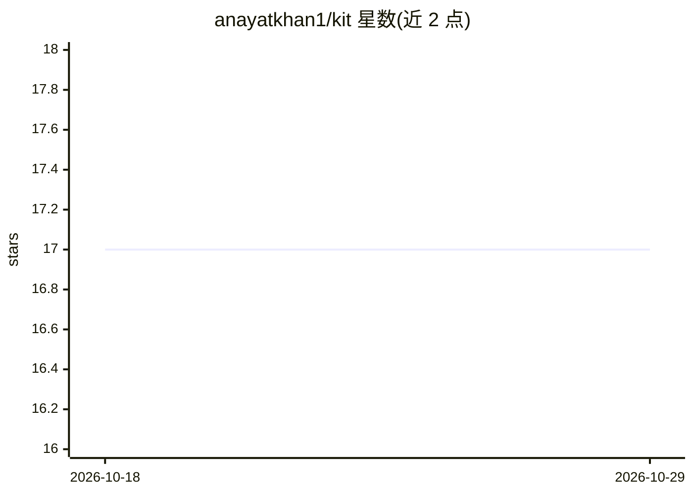

# anayatkhan1/kit

⭐ 17 · TypeScript · NOASSERTION · 推送 2026-08-04 · [GitHub](https://github.com/anayatkhan1/kit) · [官网](https://agentcn.dev) · 个人维护

**一条 CLI 命令向项目安装可编辑的 AI agent 源码**

AgentCN 是一个 agent 安装工具与注册表：通过 npx agentcn add <agent> 把 web、extraction、ecommerce 等 agent 以真实 TypeScript 源码形式拉入用户仓库（ai/agents/ 目录），提示词、工具和运行时均可编辑。托管在 agentcn.dev 的注册表提供 manifest，支持本地覆盖与 --dry-run 预览。基于 Vercel AI SDK、TypeScript 与 Anthropic Claude 构建；运行各 agent 需按类型配置 ANTHROPIC 及 EXA/ANCHOR/FIRECRAWL 等 API key。面向向应用集成 agent 的开发者。

## 筛选速览

| 维度 | 判定 | 备注 |
|---|---|---|
| AI 角色 | `ai-ecosystem` | LLM/agent 周边工具 |
| 许可风险 | `none` | NOASSERTION |
| 部署形态 | `library` | 以包/库形式分发 |
| 模型依赖 | locked-api |  |
| 硬件要求 | — | 无带数字的原话,不猜 |
| 安装摩擦 | `low` | 无编译、无系统依赖或容器化 |
| 成熟度 | — | 结构信号不足 |

## 能力要点

- CLI 将 agent 源码（提示词/工具/运行时）直接安装进用户仓库
- 托管注册表 agentcn.dev/r，支持本地注册表覆盖
- 内置 web/extraction/ecommerce 三类 agent，基于 Vercel AI SDK 与 Anthropic Claude
- 支持 --dry-run 预览文件与多种包管理器（pnpm/npx/yarn/bun）

## 适用场景

- 用一条命令为我的应用添加网页、抽取或电商 agent
- 拿到可编辑的 agent 源码自行修改提示词与工具
- 在本地注册表上开发并测试自定义 agent

## 场景标签

`Agent 框架` · 领域:Agent 开发

## 证据(README 行号)

> L22: npx agentcn@latest add web-agent
> L31: |**CLI install**|`npx agentcn add <agent>` pulls files into your project|
> L36: Built on the Vercel AI SDK, TypeScript, and Anthropic Claude.

## 星数曲线

2026-10-18 17 → 2026-10-29 17（+0）

---
*卡片 v1 · prompt 1.4 · 生成 2026-10-29 · 置信度 high · 依据 README sha `ae7bd388c0f3` · [字段定义](../../DATASET.md)*
