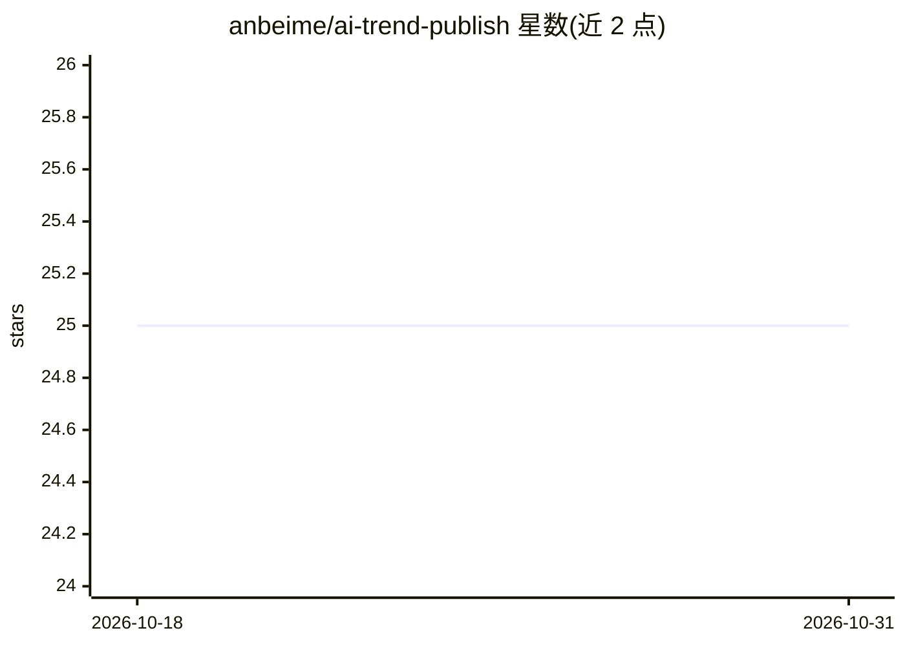

# anbeime/ai-trend-publish

⭐ 25 · JavaScript · MIT · 推送 2026-10-30 · [GitHub](https://github.com/anbeime/ai-trend-publish) · [官网](https://ai-trend-publish.vercel.app) · 个人维护 · 中文 README

**AI 内容创作全栈平台：热点采集、AI 生成、多平台自动发布**

由微信小程序、FastAPI 后端与 React 前端组成的 AI 内容创作平台，从四个项目（ai-trend-publish、tiktok-gen、cobalt、Agent-Reach）合并重构而成。功能链路为：从 Miyucaicai 热榜、V2EX、微博、知乎采集热点，经 7 步 Agent 流水线（热点→脚本→分镜→合成→质检→适配→发布）用 LLM、TTS、AI 图片与数字人视频接口生成内容，再通过微信公众号、小红书等渠道发布（抖音/B站/Twitter 为开发中状态）。内嵌 cobalt 媒体下载引擎。需自行配置各 AI 服务 API；README 含站群互引推广内容。

## 筛选速览

| 维度 | 判定 | 备注 |
|---|---|---|
| AI 角色 | `ai-native` | 本体是模型或模型工具 |
| 许可风险 | `permissive` | MIT |
| 部署形态 | `self-host` | docker 或自建部署 |
| 模型依赖 | — | README 未给出锁定关系 |
| 硬件要求 | — | 无带数字的原话,不猜 |
| 安装摩擦 | `low` | 无编译、无系统依赖或容器化 |
| 成熟度 | — | 结构信号不足 |

## 能力要点

- 7 步 Agent 工作流引擎：热点→脚本→分镜→合成→质检→适配→发布
- LLM 文案（GLM-4.7/OpenAI 兼容）、TTS（含音色克隆）、AI 图片、数字人视频四类生成能力
- 微信公众号（草稿箱 API）与小红书（Cookie）发布已实现，抖音/B站/Twitter 开发中
- 内嵌 cobalt 引擎，支持 21+ 平台媒体下载

## 适用场景

- 自动采集热点并批量生成图文/视频内容发布到公众号和小红书
- 用数字人视频和 TTS 语音制作短视频内容
- 统一管理多平台内容发布通道

## 场景标签

`工作流自动化` `AI 写作` `语音合成` `视频生成` · 领域:效率与自动化

## 证据(README 行号)

> L16: 一个集微信小程序 + FastAPI 后端 + React 前端的 **AI 内容创作全栈平台**，支持热点采集、AI 内容生成（文章/视频/数字人）、多平台自动发布。
> L39: ### AI 内容生成
> L44: - **工作流引擎** — 7 步 Agent 流水线（热点→脚本→分镜→合成→质检→适配→发布）

## 星数曲线

2026-10-18 25 → 2026-10-31 25（+0）

---
*卡片 v1 · prompt 1.4 · 生成 2026-10-27 · 置信度 high · 依据 README sha `e088003f6508` · [字段定义](../../DATASET.md)*
