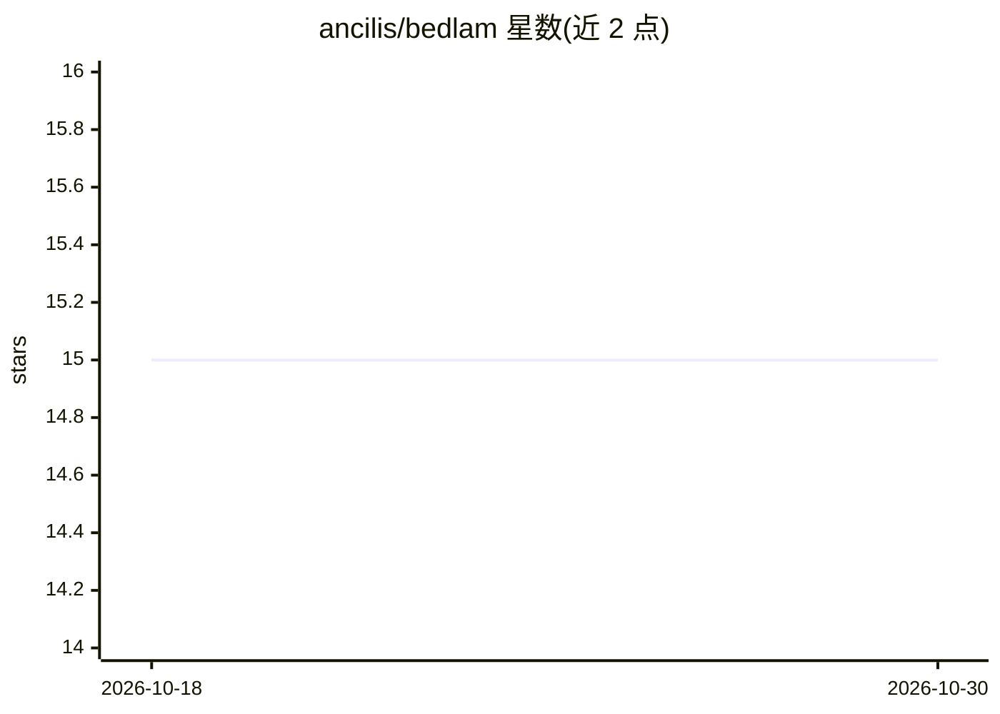

# ancilis/bedlam

⭐ 15 · TypeScript · NOASSERTION · 推送 2026-06-30 · [GitHub](https://github.com/ancilis/bedlam) · [官网](https://ancilis.ai) · 组织维护

**本地优先的 AI agent 团队编排控制平台（Paperclip fork）**

开源的本地优先多 agent 编排平台：以'AI 公司'为组织模型，提供组织架构、预算管控、审批流、执行工作区、审计账本与三档动态模型路由。机制上采用 stigmergic 间接协调（agent 通过共享环境状态自组织）、AOA 心跳信号、Reflexion 自评循环，以及带审批的 Company Reflex 自改进循环。通过适配器接入多种 agent 运行时（Claude Code CLI、Codex CLI、Gemini CLI、Cursor、OpenRouter 等），每个 agent 由 AGENTS.md+SOUL.md 定义角色与行为。内嵌 Postgres，支持 Docker Compose 与 npx 一键启动。

## 筛选速览

| 维度 | 判定 | 备注 |
|---|---|---|
| AI 角色 | `ai-ecosystem` | LLM/agent 周边工具 |
| 许可风险 | `none` | NOASSERTION |
| 部署形态 | `self-host` | docker 或自建部署 |
| 模型依赖 | locked-api |  |
| 硬件要求 | — | 无带数字的原话,不猜 |
| 安装摩擦 | `low` | 无编译、无系统依赖或容器化 |
| 成熟度 | — | 结构信号不足 |

## 能力要点

- stigmergic 协调与 AOA 心跳协议实现 agent 团队自组织
- 按任务类型的三档动态模型路由，OpenRouter 单一 API key 跨多家提供商
- AGENTS.md + SOUL.md 双文件定义 agent 角色与行为
- 带审批与审计的 Company Reflex 自改进循环
- 内置 Merger/Branch Steward/Pipeline Coordinator 等 follow-through agent 模板

## 适用场景

- 一名运营者端到端管理 AI agent 团队的目标、预算与审批
- 在本地硬件上运行可审计的 agent 工程公司（含 demo 种子数据）
- 让不同 agent 使用不同运行时与模型（本地 CLI 或 OpenRouter）
- 治理 agent 工程中的遗留 PR、分支与评审积压

## 场景标签

`多智能体` `Agent 框架` · 领域:Agent 开发

## 证据(README 行号)

> L3: **Bedlam is an open-source, local-first company AI control plane. Run AI agent teams with org charts, governed work 
> L136: ## Adapters
> L138: Adapters connect Bedlam's orchestration layer to specific agent runtimes. Each adapter knows how to invoke an agen

## 星数曲线

2026-10-18 15 → 2026-10-30 15（+0）

---
*卡片 v1 · prompt 1.4 · 生成 2026-10-30 · 置信度 high · 依据 README sha `aac0541a9895` · [字段定义](../../DATASET.md)*
