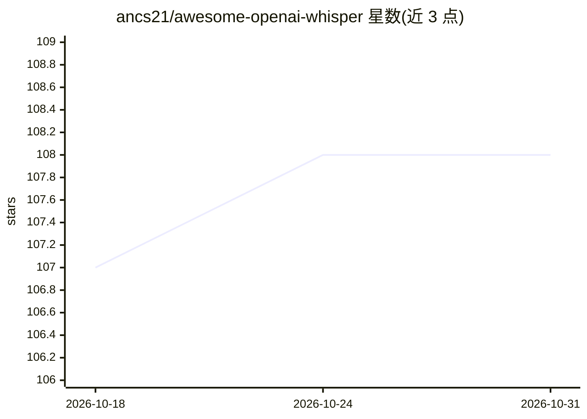

# ancs21/awesome-openai-whisper

⭐ 108 · CC0-1.0 · 推送 2026-10-10 · [GitHub](https://github.com/ancs21/awesome-openai-whisper) · 个人维护

**OpenAI Whisper 生态资源策展清单：模型变体、应用与教程**

围绕 OpenAI Whisper 语音识别模型的策展清单（awesome list），按通用资源、API/演示、模型变体、应用、视频、教程、文章等类别组织条目。收录内容包括 whisper.cpp、Faster Whisper、Whisper JAX 等模型实现，字幕生成、流式转录、说话人识别等应用，以及多平台教程视频。面向需要查找 Whisper 相关工具、实现与学习资料的开发者与使用者，条目以链接列表形式组织，不含代码实现。

## 筛选速览

| 维度 | 判定 | 备注 |
|---|---|---|
| AI 角色 | `ai-knowledge` | 知识聚合/清单类 |
| 许可风险 | `viral` | CC0-1.0 |
| 部署形态 | `None` |  |
| 模型依赖 | — | README 未给出锁定关系 |
| 硬件要求 | — | 无带数字的原话,不猜 |
| 安装摩擦 | `low` | 无编译、无系统依赖或容器化 |
| 成熟度 | — | 结构信号不足 |

## 能力要点

- 按模型变体、应用、教程、文章等类别组织条目
- 收录 whisper.cpp、Faster Whisper、Whisper JAX 等多种实现
- 覆盖字幕生成、流式转录、说话人识别等应用条目

## 适用场景

- 为语音转文字项目挑选合适的 Whisper 实现或部署方式
- 查找 Whisper 相关教程与学习资料
- 了解 Whisper 生态中的应用与工具覆盖范围

## 场景标签

`精选清单` · 领域:学习与行业

## 证据(README 行号)

> L1: # awesome-openai-whisper
> L2: A curated list of awesome OpenAI's Whisper

## 星数曲线

2026-10-18 107 → 2026-10-31 108（+1）

---
*卡片 v1 · prompt 1.4 · 生成 2026-10-23 · 置信度 high · 依据 README sha `ca9a30051031` · [字段定义](../../DATASET.md)*
