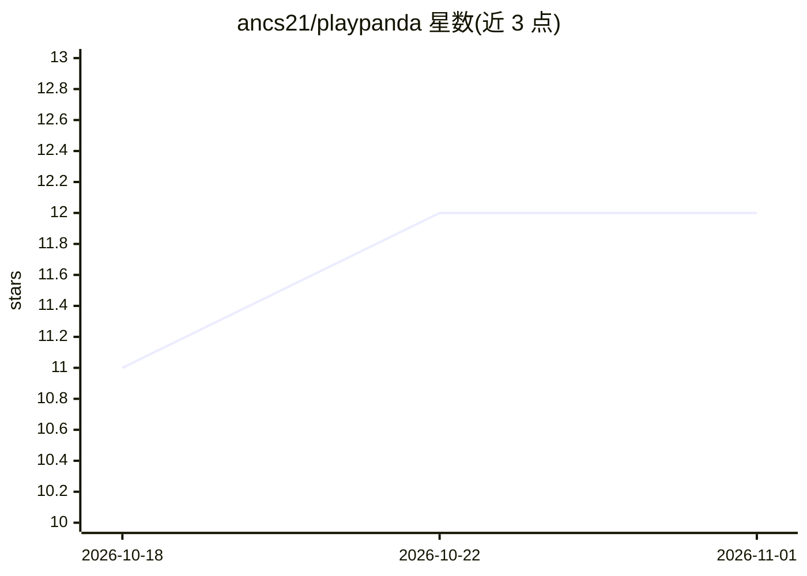

# ancs21/playpanda

⭐ 12 · Zig · Apache-2.0 · 推送 2026-10-10 · [GitHub](https://github.com/ancs21/playpanda) · 个人维护

**将任意网页抓取为 LLM 可用 markdown 的单文件 CLI 工具**

用 Zig 编写的网页转 markdown 命令行工具，单一二进制、零配置。核心是三级自动升级抓取引擎：Tier 1 用原生 HTTP 加 Zig 实现的 HTML 转 markdown（约 150ms），内容为空或损坏时升级到 Tier 2 Lightpanda 无头浏览器，再被封锁时升级到 Tier 3 CloakBrowser 隐身浏览器处理反爬站点。支持交互式登录采集 Cookie（存于 ~/.playpanda/cookies.json）并按域名自动匹配注入，facebook、linkedin 等 14 个域名自动走 Tier 3。面向需要为 LLM 准备干净网页文本的开发者。

## 筛选速览

| 维度 | 判定 | 备注 |
|---|---|---|
| AI 角色 | `ai-ecosystem` | LLM/agent 周边工具 |
| 许可风险 | `permissive` | Apache-2.0 |
| 部署形态 | `library` | 以包/库形式分发 |
| 模型依赖 | — | README 未给出锁定关系 |
| 硬件要求 | — | 无带数字的原话,不猜 |
| 安装摩擦 | `low` | 无编译、无系统依赖或容器化 |
| 成熟度 | — | 结构信号不足 |

## 能力要点

- 三级自动升级抓取引擎：HTTP → Lightpanda 无头浏览器 → CloakBrowser 隐身浏览器
- 交互式登录流程，经 CDP 采集 Cookie 并自动按域名匹配注入
- 单一二进制、零配置、无需 API key
- 14 个反爬保护域名自动使用隐身浏览器抓取

## 适用场景

- 把网页文章转成干净 markdown 喂给 LLM
- 抓取需要登录的站点内容并保持会话
- 抓取 Facebook/LinkedIn 等有反爬保护的页面

## 场景标签

`网页抓取` · 领域:效率与自动化

## 证据(README 行号)

> L17: Fetch any webpage as clean, LLM-ready markdown. Single binary, zero config.
> L39: |1|HTTP + native Zig HTML-to-markdown|~150ms|Default for most sites|
> L41: |3|CloakBrowser|~6s|Bot-protected sites (Facebook, LinkedIn, Medium, etc.)|

## 星数曲线

2026-10-18 11 → 2026-11-01 12（+1）

---
*卡片 v1 · prompt 1.4 · 生成 2026-11-01 · 置信度 high · 依据 README sha `1d64c54f3599` · [字段定义](../../DATASET.md)*
