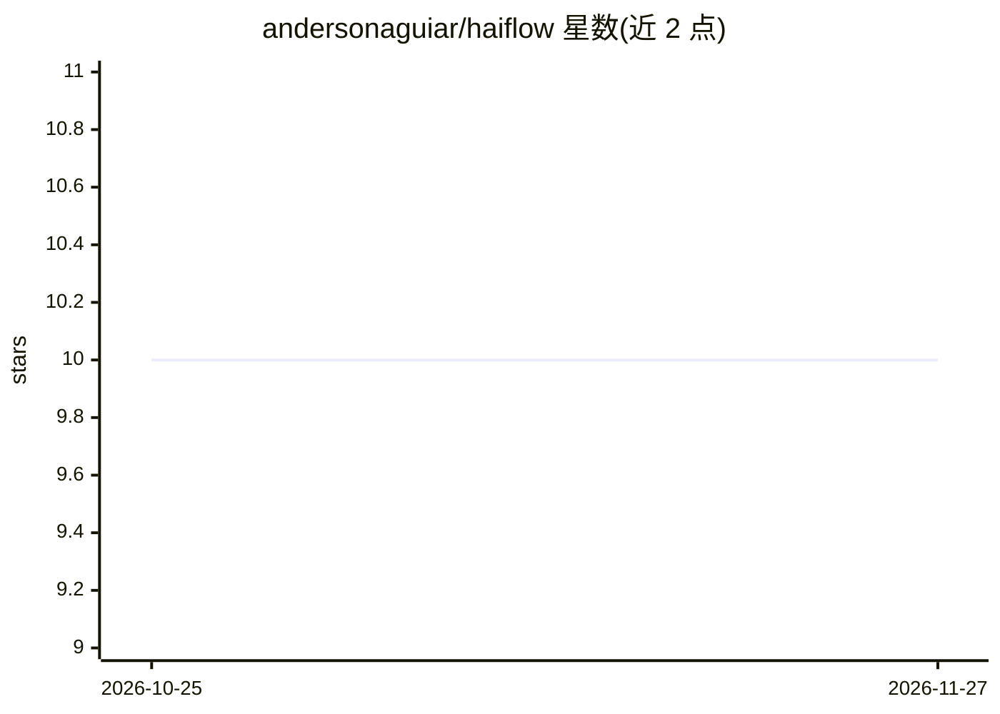

# andersonaguiar/haiflow

⭐ 10 · TypeScript · MIT · 推送 2026-10-28 · [GitHub](https://github.com/andersonaguiar/haiflow) · 个人维护

**把 Claude Code 变成 HTTP 无头 agent 的编排服务器**

以 tmux 会话封装 Claude Code CLI，暴露 REST API 用于触发提示、排队任务和捕获响应，复用现有订阅而无需按 token 付费的 API。支持事件驱动的 pub/sub 流水线串联多个 agent，内置 Web 仪表盘监控会话、SQLite 任务台账记录工具调用与 diff、出站密钥脱敏。仅支持 macOS/Linux，依赖 Bun、tmux、jq、Claude Code CLI，Redis 可选用于事件持久化。

## 筛选速览

| 维度 | 判定 | 备注 |
|---|---|---|
| AI 角色 | `ai-ecosystem` | LLM/agent 周边工具 |
| 许可风险 | `permissive` | MIT |
| 部署形态 | `self-host` | docker 或自建部署 |
| 模型依赖 | locked-api |  |
| 硬件要求 | — | 无带数字的原话,不猜 |
| 安装摩擦 | `low` | 无编译、无系统依赖或容器化 |
| 成熟度 | — | 结构信号不足 |

## 能力要点

- REST API 触发/排队/捕获 Claude Code 任务，附带 Web 仪表盘实时监控
- 事件驱动 pub/sub 多 agent 流水线，可选 Redis 持久化与重试
- SQLite 任务台账：工具调用、diff、token 用量与等效 API 成本估算
- 出站密钥脱敏与生产模式安全约束（公网绑定需显式确认）

## 适用场景

- 用 n8n/cron/webhook 自动化代码生成、重构与 bug 分诊
- 多个 agent 按事件链路串联协作（设计→开发→评审→QA）
- 通过浏览器仪表盘查看、接管卡住的 agent 会话

## 场景标签

`编码 Agent` `多智能体` · 领域:Agent 开发

## 证据(README 行号)

> L13: Run Claude Code as a headless AI agent over HTTP — no API key costs, no SDK, just your existing Claude Code subscri
> L15: Haiflow wraps Claude Code in tmux sessions and exposes a REST API to trigger prompts, queue work, and capture respo
> L30: Chain agents together with event-driven pub/sub. Each agent subscribes to topics it cares about and emits events wh

## 星数曲线

2026-10-25 10 → 2026-11-27 10（+0）

---
*卡片 v1 · prompt 1.4 · 生成 2026-11-20 · 置信度 mid · 依据 README sha `915c1be10b54` · [字段定义](../../DATASET.md)*
