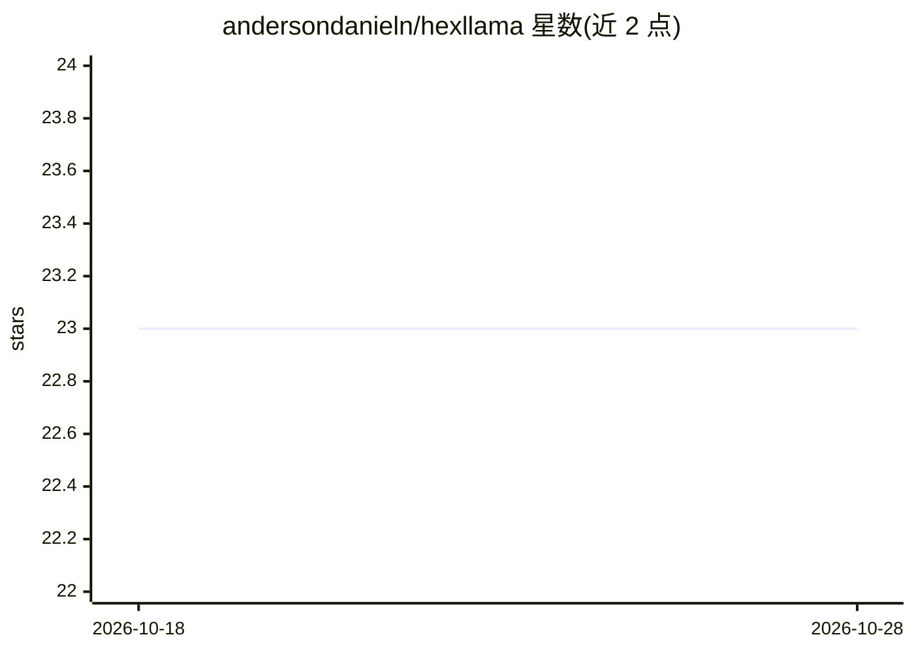

# andersondanieln/hexllama

⭐ 23 · TypeScript · MIT · 推送 2026-05-25 · [GitHub](https://github.com/andersondanieln/hexllama) · 个人维护

**桌面客户端：管理并用 llama.cpp 运行本地 LLM**

基于 Electron/React/TypeScript 的本地大模型管理桌面应用：内置 Hugging Face 搜索与 GGUF 一键下载（支持暂停/续传），下载完成后按参数量与量化级别自动生成执行模板；支持多端口同时运行多个模型、切换 llama.cpp 后端二进制版本、以图形界面编辑服务端命令参数，可启动内置 Chat UI 或纯 API 模式。提供预编译安装包，也可用 Node.js 18+ 从源码构建。路线图中计划支持 MLX、vLLM 等替代后端。

## 筛选速览

| 维度 | 判定 | 备注 |
|---|---|---|
| AI 角色 | `ai-ecosystem` | LLM/agent 周边工具 |
| 许可风险 | `permissive` | MIT |
| 部署形态 | `desktop` | 安装包/桌面程序 |
| 模型依赖 | local-ok | 支持本地模型 |
| 硬件要求 | — | 无带数字的原话,不猜 |
| 安装摩擦 | `low` | 无编译、无系统依赖或容器化 |
| 成熟度 | — | 结构信号不足 |

## 能力要点

- Hugging Face 内置搜索与 GGUF 下载管理（暂停/续传/取消）
- 下载完成自动生成含线程数、批大小、上下文窗口的执行模板
- 多端口同时运行多个模型，可切换 llama.cpp 后端二进制版本
- 图形化命令编辑器替代命令行参数

## 适用场景

- 不想用命令行，希望在桌面端管理本地 GGUF 模型
- 同时运行多个本地模型并分别提供 API 服务
- 跟踪并切换 llama.cpp 后端版本以适配新模型

## 场景标签

`推理引擎` · 领域:训练与推理

## 证据(README 行号)

> L9: Hexllama is a fast, native desktop interface designed to streamline managing and running local Large Language Models
> L32: **Version and Backend Management**

## 星数曲线

2026-10-18 23 → 2026-10-28 23（+0）

---
*卡片 v1 · prompt 1.4 · 生成 2026-10-27 · 置信度 high · 依据 README sha `87ebd44921ab` · [字段定义](../../DATASET.md)*
