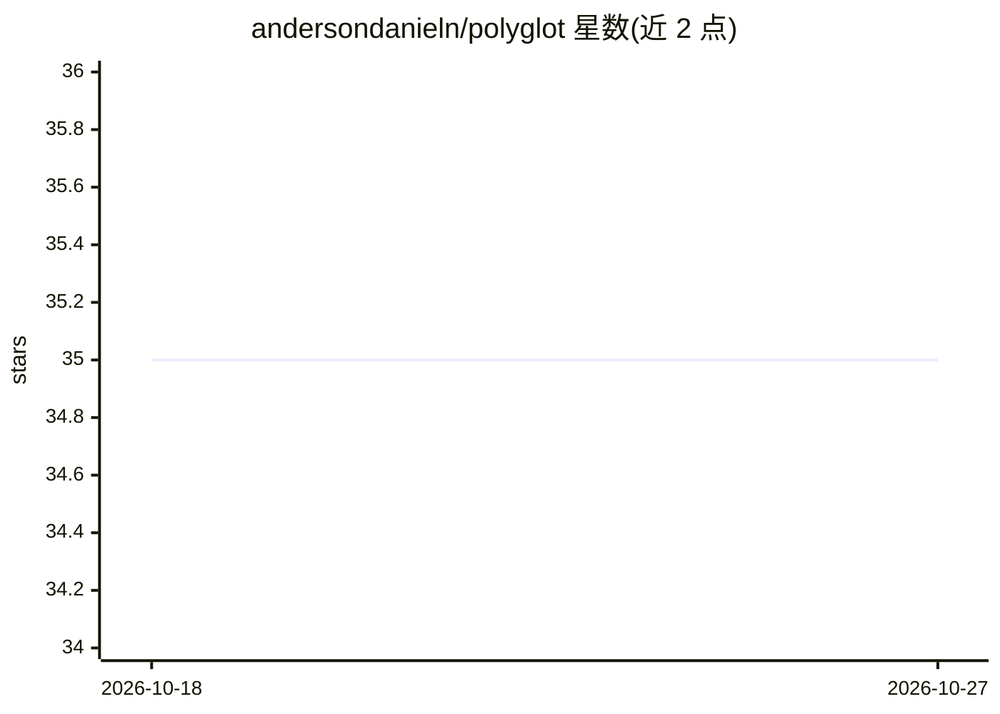

# andersondanieln/polyglot

⭐ 35 · TypeScript · NOASSERTION · 推送 2025-12-29 · [GitHub](https://github.com/andersondanieln/polyglot) · [官网](https://andercoder.com/polyglot) · 个人维护

**本地 AI 桌面翻译与文本改写工具：划词快捷键即时处理**

基于 Electron/React/TypeScript 的桌面应用，接入用户本地 Ollama 实例：选中文本后按全局快捷键即时翻译（葡/英/西/中），并可通过文本后缀执行语法纠正（::fix）、语气改写（::formal/::friendly）、摘要与扩缩写（::summarize/::shorten/::expand）等操作。所有处理在本机完成，文本不离开本地。面向普通用户提供 .exe 安装包，开发者需 Node.js 18+、Ollama 及已下载模型后从源码运行。采用自定义许可：个人非商业用途免费，商业用途需联系作者授权。

## 筛选速览

| 维度 | 判定 | 备注 |
|---|---|---|
| AI 角色 | `ai-native` | 本体是模型或模型工具 |
| 许可风险 | `none` | NOASSERTION |
| 部署形态 | `desktop` | 安装包/桌面程序 |
| 模型依赖 | local-ok | 支持本地模型 |
| 硬件要求 | — | 无带数字的原话,不猜 |
| 安装摩擦 | `low` | 无编译、无系统依赖或容器化 |
| 成熟度 | — | 结构信号不足 |

## 能力要点

- 全局快捷键划词翻译，跨应用（浏览器/编辑器/通讯软件）原位生效
- 后缀命令扩展为写作助手：纠正语法、改语气、摘要/扩缩写
- 全部处理经本地 Ollama 完成，数据不离开本机
- 支持 EN/PT/ES/ZH 界面语言与亮暗主题

## 适用场景

- 日常阅读外文资料时划词即时翻译
- 在任意应用中纠正语法或改写语气而不上传文本
- 本地模型环境下对长文做摘要或扩写

## 场景标签

`AI 助手` `AI 写作` · 领域:对话与助手

## 证据(README 行号)

> L20: By integrating with your local Ollama instance, it allows you to select any text on your screen, press a global sho
> L22: But it doesn't stop there. Polyglot Air is also a powerful writing assistant. Using simple text suffixes, you can c
> L36:  All processing is done on your machine through Ollama. Your selected text, prompts, and generated content never le

## 星数曲线

2026-10-18 35 → 2026-10-27 35（+0）

---
*卡片 v1 · prompt 1.4 · 生成 2026-10-25 · 置信度 mid · 依据 README sha `c22622071ef5` · [字段定义](../../DATASET.md)*
