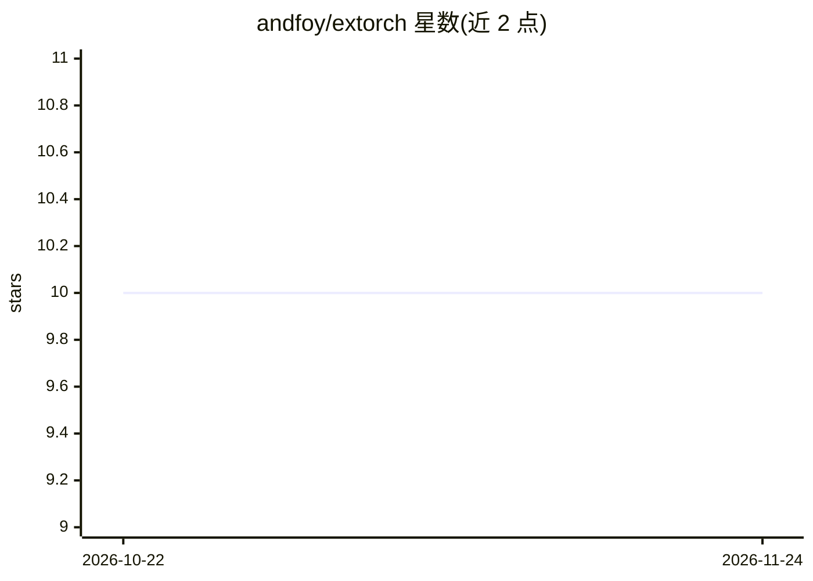

# andfoy/extorch

⭐ 10 · Elixir · MIT · 推送 2026-06-14 · [GitHub](https://github.com/andfoy/extorch) · 个人维护

**在 Elixir/BEAM 中直接加载运行 PyTorch 模型的绑定库**

嵌入 BEAM 应用的库，用于加载在 Python 侧序列化的 PyTorch 模型（AOTInductor .pt2 与 torch.export .pt2）并执行前向推理，无需 Python 进程或 ONNX 转换。提供 load+forward 执行原语、四条推理路径、与 Nx 的零拷贝张量交换、经 c10::Dispatcher 的算子扩展机制、telemetry 钩子与热重载示例。不内置动态批处理、多模型调度或 HTTP 服务层，批处理与服务编排交给用户基于 Phoenix/GenServer 等 OTP 工具自行组合。需 Elixir ≥1.16 与 Rust 工具链编译。

## 筛选速览

| 维度 | 判定 | 备注 |
|---|---|---|
| AI 角色 | `ai-ecosystem` | LLM/agent 周边工具 |
| 许可风险 | `permissive` | MIT |
| 部署形态 | `None` |  |
| 模型依赖 | — | README 未给出锁定关系 |
| 硬件要求 | — | 无带数字的原话,不猜 |
| 安装摩擦 | `high` | 编译与系统依赖俱全 |
| 成熟度 | — | 结构信号不足 |

## 能力要点

- 加载 AOTInductor/torch.export .pt2 模型，输出与 Python 位级一致（11 个模型验证）
- 与 Nx/Torchx 经指针交换实现零拷贝张量共享
- c10::Dispatcher 桥接允许 Elixir 包注册自定义算子，ExTorch.Vision 即以该方式提供 torchvision 算子
- 四条推理路径：解释器、native、预编译图、AOTI

## 适用场景

- 在既有 BEAM/Elixir 应用中加入 PyTorch 模型推理而无需维护 Python 运行时
- 在 Phoenix/Broadway 管线中嵌入推理并自行定制批处理与容错
- 对推理延迟与输出一致性有验证需求的 Elixir 服务

## 场景标签

`推理引擎` · 领域:训练与推理

## 证据(README 行号)

> L9: A library you embed in your BEAM application to run PyTorch models you've already serialized elsewhere. It gives you
> L13: - Not a serving platform. There is no built-in dynamic batching, request coalescing, multi-model scheduler, or HTTP
> L3: **PyTorch bindings for Elixir — Python-free.** Load and execute serialized PyTorch models (`.pt2` AOTInductor, `.pt2

## 星数曲线

2026-10-22 10 → 2026-11-24 10（+0）

---
*卡片 v1 · prompt 1.4 · 生成 2026-11-20 · 置信度 high · 依据 README sha `053dd7f053a6` · [字段定义](../../DATASET.md)*
