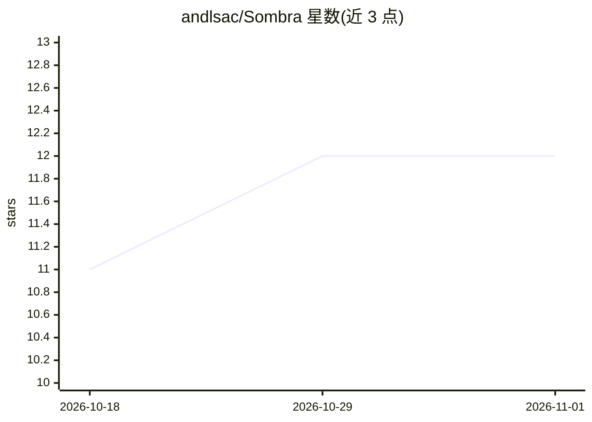

# andlsac/Sombra

⭐ 12 · Swift · MIT · 推送 2026-06-08 · [GitHub](https://github.com/andlsac/Sombra) · 个人维护 · 中文 README

**macOS 本地 AI 补全与拼写纠错菜单栏应用，Tab 接受**

面向 Apple Silicon Mac 用户（M1–M4，macOS 14+）的菜单栏输入辅助应用：通过 llama.cpp + Metal 在本机运行小语言模型，预测光标前文字的续写并以气泡展示，按 Tab 逐词接受；配合 macOS 原生拼写检查器纠错（含缺失重音符号）。支持多语言检测、表情符号快捷输入、按应用屏蔽/定制提示词、可选 OCR 屏幕上下文（默认关闭）。无网络连接、无遥测；应用不内置模型，首次启动从目录下载（Gemma/Qwen 小模型）或导入 .gguf。作者声明为个人项目，不承诺支持或稳定性，需自行编译构建。

## 筛选速览

| 维度 | 判定 | 备注 |
|---|---|---|
| AI 角色 | `ai-native` | 本体是模型或模型工具 |
| 许可风险 | `permissive` | MIT |
| 部署形态 | `desktop` | 安装包/桌面程序 |
| 模型依赖 | local-ok | 支持本地模型 |
| 硬件要求 | — | 无带数字的原话,不猜 |
| 安装摩擦 | `low` | 无编译、无系统依赖或容器化 |
| 成熟度 | `idea` | |

## 能力要点

- llama.cpp + Metal 全本地推理，正常使用无网络连接
- 逐词补全 + 原生拼写纠错（含重音缺失如 voce→você）
- 应用约 16MB 不含模型，首次启动下载或导入 .gguf
- 按应用规则（屏蔽密码管理器、定制提示词）与可选个人词库学习

## 适用场景

- 在 Mac 任意应用中获得逐词 AI 补全建议
- 离线环境下进行多语言拼写纠错
- 为不同应用设置不同的 AI 写作风格提示

## 场景标签

`AI 写作` · 领域:内容生成

## 证据(README 行号)

> L21: Sombra predicts the continuation of what you're typing and shows it in a **bubble
> L33: - Inference is **100% local** (`llama.cpp` + Metal). No cloud, no telemetry.
> L96: - macOS 14+ and **Apple Silicon** (M1–M4)

## 星数曲线

2026-10-18 11 → 2026-11-01 12（+1）

---
*卡片 v1 · prompt 1.4 · 生成 2026-11-01 · 置信度 high · 依据 README sha `3bef7d273f76` · [字段定义](../../DATASET.md)*
