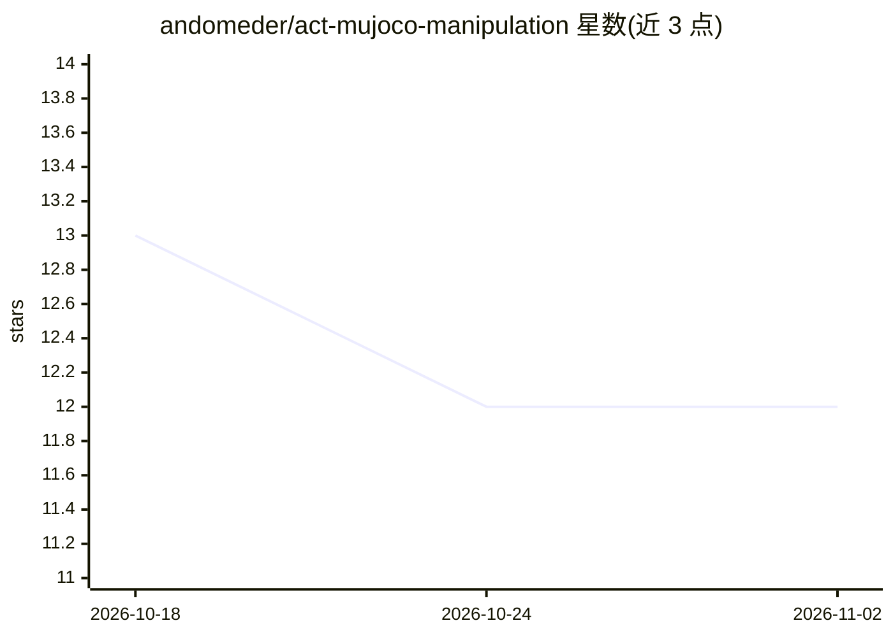

# andomeder/act-mujoco-manipulation

⭐ 12 · Python · MIT · 推送 2025-12-19 · [GitHub](https://github.com/andomeder/act-mujoco-manipulation) · 个人维护

**机器人操作模仿学习的 ACT 端到端 PyTorch 实现（MuJoCo 仿真）**

基于 PyTorch 从零实现 Action Chunking Transformer (ACT)：用条件 VAE 与 transformer 编解码器预测未来动作序列（action chunk），配合时序集成平滑控制。在 MuJoCo 仿真中以 ROBOTIS FFW 人形机器人执行 pick-and-place 任务，提供终端遥操作数据采集（make collect-data）、训练（make train）、评估与视频生成（make eval）的完整流程，用 Hydra 管理配置、WandB 跟踪实验。支持 NVIDIA CUDA / Intel Arc / AMD ROCm 多 GPU，无 GPU 时可用 CPU。训练 2000 epochs 约 3-4 小时（Intel Arc）。

## 筛选速览

| 维度 | 判定 | 备注 |
|---|---|---|
| AI 角色 | `ai-native` | 本体是模型或模型工具 |
| 许可风险 | `permissive` | MIT |
| 部署形态 | `None` |  |
| 模型依赖 | — | README 未给出锁定关系 |
| 硬件要求 | — | 无带数字的原话,不猜 |
| 安装摩擦 | `medium` | 含编译或系统依赖之一 |
| 成熟度 | — | 结构信号不足 |

## 能力要点

- ACT（CVAE + transformer）从零 PyTorch 实现，chunk_size=100
- 终端遥操作采集演示数据，建议 10-50 episodes（6,000+ 帧）
- 评估流水线输出成功率与 MP4 视频
- 自动检测并配置 NVIDIA / Intel Arc / AMD ROCm GPU

## 适用场景

- 在 MuJoCo 仿真中学习机器人抓放操作策略
- 复现或修改 ACT 架构做机器人模仿学习实验
- 对比 ACT 与行为克隆、Diffusion Policy 的训练与推理方式

## 场景标签

 · 领域:机器人/具身智能

## 证据(README 行号)

> L7: End-to-end implementation of **Action Chunking Transformers (ACT)** for imitation learning in robot manipulation tas
> L11: This project demonstrates imitation learning for robotic manipulation using the **Action Chunking Transformer (ACT)
> L15: - ✅ **Full ACT implementation** from scratch in PyTorch

## 星数曲线

2026-10-18 13 → 2026-11-02 12（-1）

---
*卡片 v1 · prompt 1.4 · 生成 2026-11-01 · 置信度 high · 依据 README sha `e9b51c30d4f1` · [字段定义](../../DATASET.md)*
