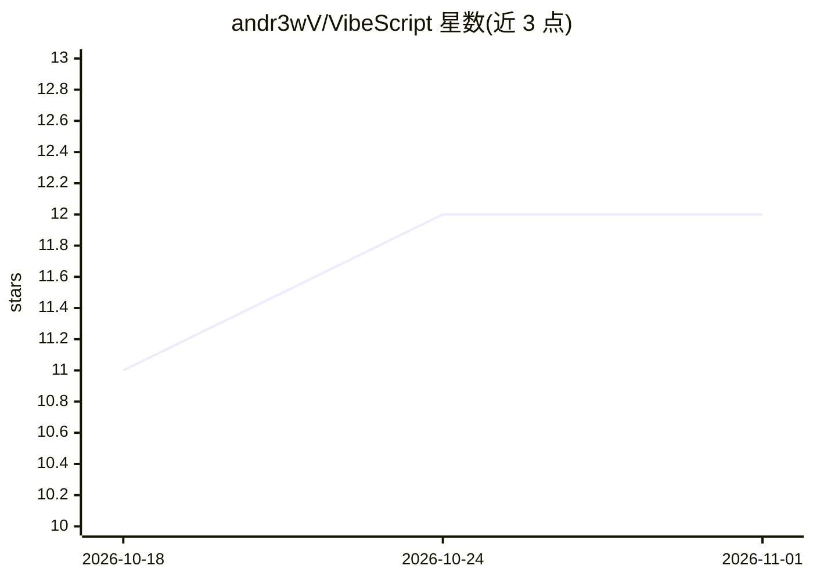

# andr3wV/VibeScript

⭐ 12 · TypeScript · 推送 2025-12-12 · [GitHub](https://github.com/andr3wV/VibeScript) · [官网](https://www.npmjs.com/package/vibescript) · 个人维护

**用自然语言描述生成网页应用的提示词驱动编程语言**

VibeScript 是一门以英文描述为源码的编程语言：用户在 .vibe 文件中用自然语言描述组件，CLI 调用 OpenAI 模型（gpt-5.1/gpt-5-mini/gpt-5-nano/gpt-oss-120b/gpt-oss-20b）生成 HTML 输出到 dist/。支持组件嵌套、按模型分缓存、--watch 热重载、--deploy 部署到 Vercel、vibe lint 检查描述规范，Supabase 数据源支持标注为 BETA。安装为 npm 全局包，运行需 OpenAI API key，可用 .env 或直接写入 .vibe 文件（后者会泄露密钥）。README 语调为戏谑风格。

## 筛选速览

| 维度 | 判定 | 备注 |
|---|---|---|
| AI 角色 | `ai-native` | 本体是模型或模型工具 |
| 许可风险 | `none` | — |
| 部署形态 | `library` | 以包/库形式分发 |
| 模型依赖 | — | README 未给出锁定关系 |
| 硬件要求 | — | 无带数字的原话,不猜 |
| 安装摩擦 | `low` | 无编译、无系统依赖或容器化 |
| 成熟度 | — | 结构信号不足 |

## 能力要点

- 自然语言描述组件，LLM 生成 HTML 网站输出到 dist/
- 5 个可选生成模型，各模型缓存独立
- --watch 热重载与 --deploy 一键部署 Vercel
- vibe lint 检查描述质量、未用组件与缺失页面

## 适用场景

- 用自然语言快速生成静态网页原型
- 不写代码搭建带组件嵌套的展示页
- 配合 Supabase（BETA）生成数据读写代码

## 场景标签

`代码生成` · 领域:编码与开发

## 证据(README 行号)

> L9: VibeScript compiles your vibes into a production-ready app using our proprietary AI. It's like React, but instead of
> L117: VibeScript lets you choose which in-house, proprietary LLM to use for generating your vibes.
> L147: - `model` – Default OpenAI model to use for component generation. **Recommended: gpt-5.1 for best results.**

## 星数曲线

2026-10-18 11 → 2026-11-01 12（+1）

---
*卡片 v1 · prompt 1.4 · 生成 2026-11-01 · 置信度 high · 依据 README sha `2034b45eb608` · [字段定义](../../DATASET.md)*
