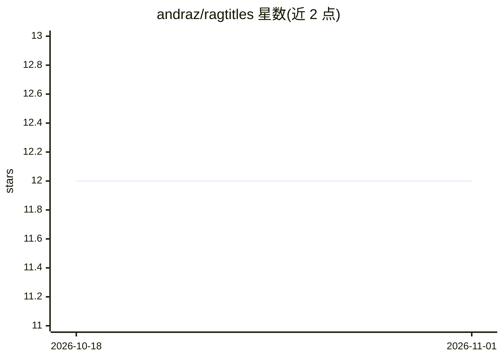

# andraz/ragtitles

⭐ 12 · TypeScript · MIT · 推送 2026-02-14 · [GitHub](https://github.com/andraz/ragtitles) · 个人维护

**将 YouTube 自动生成 VTT 字幕转为 RAG 友好格式的 npm 库**

npm 模块，读取 YouTube 自动生成的词级时间戳 VTT 字幕，转换为名为 ragtitles 的数组格式：每条对象含秒级时间戳与对应文本，保留词到视频时间戳的 1:1 映射用于回放定位。输出可拼接为字符串直接注入 LLM 上下文，并通过 SponsorBlock 数据自动过滤推广等垃圾片段。提供 CLI 工具，支持传入本地 VTT 文件或 YouTube URL（经 yt-dlp 下载字幕）；DevContainer 环境自动安装 yt-dlp。面向构建 RAG 管道的开发者。

## 筛选速览

| 维度 | 判定 | 备注 |
|---|---|---|
| AI 角色 | `ai-ecosystem` | LLM/agent 周边工具 |
| 许可风险 | `permissive` | MIT |
| 部署形态 | `library` | 以包/库形式分发 |
| 模型依赖 | — | README 未给出锁定关系 |
| 硬件要求 | — | 无带数字的原话,不猜 |
| 安装摩擦 | `low` | 无编译、无系统依赖或容器化 |
| 成熟度 | — | 结构信号不足 |

## 能力要点

- 词级时间戳 VTT 转为时间戳+文本数组，保留词到视频时间 1:1 映射
- CLI 支持直接传 YouTube URL，经 yt-dlp 下载并转换字幕
- 基于 SponsorBlock 数据自动过滤推广/预览等垃圾片段
- 输出可映射为带秒前缀的字符串直接注入 LLM 上下文

## 适用场景

- 把 YouTube 视频字幕导入 RAG 系统或 LLM 上下文
- 让 LLM 根据带时间戳的转录定位视频关键片段
- 清洗字幕中的广告与无关内容以降低 token 成本

## 场景标签

`文档解析` · 领域:知识与检索

## 证据(README 行号)

> L5: This npm module converts standard YouTube autogenerated word-timestamped VTT subtitles into a RAG-friendly format we
> L7: This format makes timestamped subtitles token-optimized to be suitable for use with Retrieval Augmented Generation (

## 星数曲线

2026-10-18 12 → 2026-11-01 12（+0）

---
*卡片 v1 · prompt 1.4 · 生成 2026-11-01 · 置信度 mid · 依据 README sha `f2c987b948e9` · [字段定义](../../DATASET.md)*
