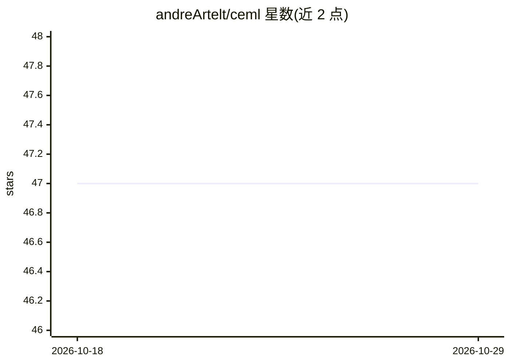

# andreArtelt/ceml

⭐ 47 · Python · MIT · 推送 2026-07-17 · [GitHub](https://github.com/andreArtelt/ceml) · 个人维护

**计算反事实以解释机器学习模型预测的 Python 工具箱**

面向开发者的可解释 AI 工具箱：对已训练的机器学习模型，针对给定数据点计算反事实样本（最小改动使预测变为目标值），以此解释模型预测。支持 scikit-learn、PyTorch、Keras/TensorFlow 等常见框架，提供特征白名单约束，可扩展。限制：要求 Python 3.8，在 Ubuntu 上测试（Windows 有依赖问题报告），PyPI 包仅含 CPU 版本，GPU 需手动安装。

## 筛选速览

| 维度 | 判定 | 备注 |
|---|---|---|
| AI 角色 | `ai-ecosystem` | LLM/agent 周边工具 |
| 许可风险 | `permissive` | MIT |
| 部署形态 | `library` | 以包/库形式分发 |
| 模型依赖 | — | README 未给出锁定关系 |
| 硬件要求 | `cpu-ok` | |
| 安装摩擦 | `low` | 无编译、无系统依赖或容器化 |
| 成熟度 | — | 结构信号不足 |

## 能力要点

- 计算反事实解释机器学习模型预测
- 支持 scikit-learn、PyTorch、Keras/TensorFlow 框架
- 特征白名单约束反事实搜索范围
- 提供 pip 安装与源码安装两种方式，MIT 许可

## 适用场景

- 解释分类模型对单个样本的预测依据
- 生成符合约束（不可改某些特征）的反事实样本
- 为已训练模型做可解释性分析

## 场景标签

`模型评测` · 领域:评测与运维

## 证据(README 行号)

> L4: CEML is a Python toolbox for computing counterfactuals. Counterfactuals can be used to explain the predictions of ma
> L6: It supports many common machine learning frameworks:

## 星数曲线

2026-10-18 47 → 2026-10-29 47（+0）

---
*卡片 v1 · prompt 1.4 · 生成 2026-10-25 · 置信度 high · 依据 README sha `c4c5c289ea80` · [字段定义](../../DATASET.md)*
