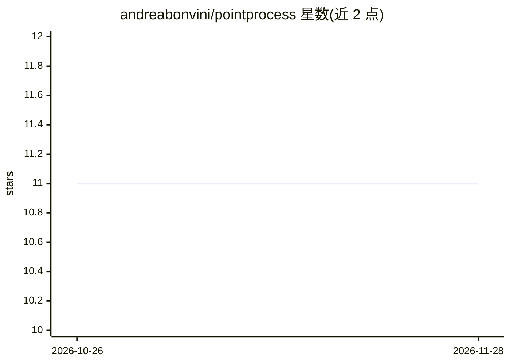

# andreabonvini/pointprocess

⭐ 11 · C++ · MIT · 推送 2026-04-05 · [GitHub](https://github.com/andreabonvini/pointprocess) · [官网](https://pointprocess.readthedocs.io/en/latest/) · 个人维护

**心率变异性点过程分析的 C++/Python 库**

基于 Barbieri 与 Citi 的 MATLAB 软件改写的现代 C++ 点过程模型库，面向心率变异性（HRV）分析。支持逆高斯、高斯、对数正态等多种分布模型，提供状态空间回归、时变滑窗回归与谱分析功能，通过 Python 绑定以 NumPy/SciPy 集成，并给出单窗回归、谱分析、全时序回归的 API。经 PyPI 分发预编译 wheel（Python 3.9–3.13），开发环境用 nox 管理，附 Jupyter 示例与引用文献。

## 筛选速览

| 维度 | 判定 | 备注 |
|---|---|---|
| AI 角色 | `ai-native` | 本体是模型或模型工具 |
| 许可风险 | `permissive` | MIT |
| 部署形态 | `library` | 以包/库形式分发 |
| 模型依赖 | — | README 未给出锁定关系 |
| 硬件要求 | — | 无带数字的原话,不猜 |
| 安装摩擦 | `medium` | 含编译或系统依赖之一 |
| 成熟度 | — | 结构信号不足 |

## 能力要点

- C++ 实现并附带 Python 绑定，经 PyPI 分发预编译 wheel
- 支持 Inverse Gaussian/Gaussian/LogNormal 多种分布模型
- 提供状态空间回归、滑窗时变回归与谱分析
- 跨平台支持 Linux/Windows/macOS

## 适用场景

- 对 RR 间期序列做点过程模型回归拟合
- 从模型参数计算心率变异性的功率谱密度
- 用滑窗方式分析心率变异性的时变特征

## 场景标签

 · 领域:计算神经科学/生理信号分析

## 证据(README 行号)

> L9: A modern C++ implementation of point process models for heart rate variability (HRV) analysis. Based on the MATLAB s
> L13: - Multiple distribution models (Inverse Gaussian, Gaussian, LogNormal)
> L14: - State-space regression and spectral analysis

## 星数曲线

2026-10-26 11 → 2026-11-28 11（+0）

---
*卡片 v1 · prompt 1.4 · 生成 2026-11-18 · 置信度 high · 依据 README sha `6adaa473ada2` · [字段定义](../../DATASET.md)*
