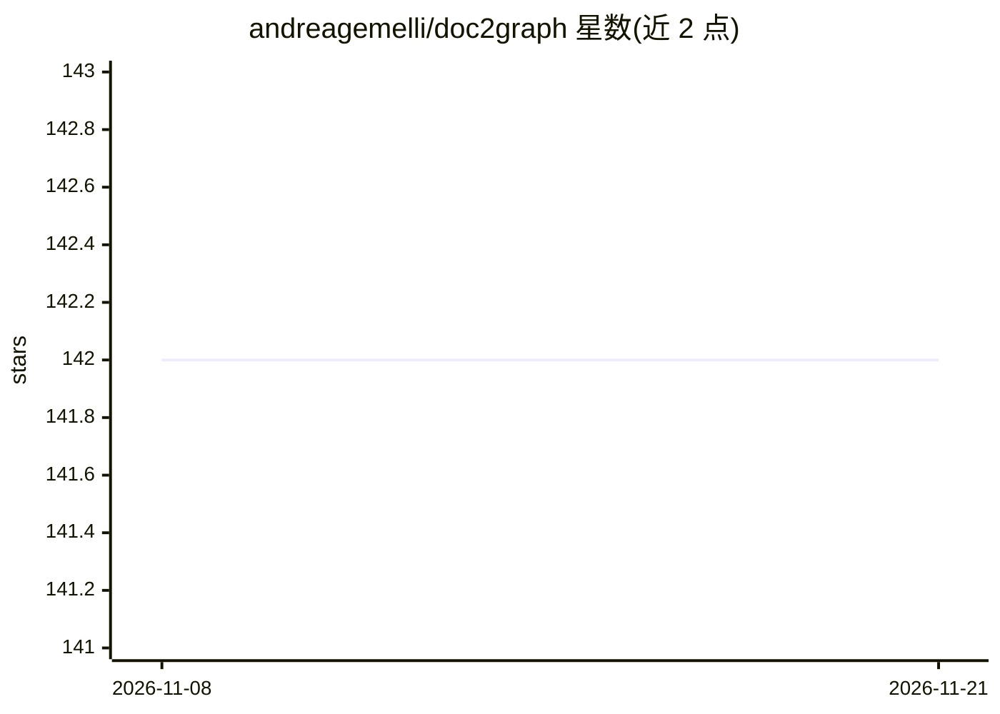

# andreagemelli/doc2graph

⭐ 142 · Jupyter Notebook · MIT · 推送 2026-11-03 · [GitHub](https://github.com/andreagemelli/doc2graph) · [官网](https://deepwiki.com/andreagemelli/doc2graph/1-overview) · 个人维护

**将文档转成图并用 GNN 做任务无关理解的 PyTorch 库**

ECCV 2022 TiE 论文的官方实现：把文档（表单、业务文档等）表示为图，节点为词/实体区域，用图神经网络完成语义实体标注、实体链接、版面分析与表格检测等任务。基于 PyTorch Geometric（v0.3.0 起替代已停止维护的 DGL），提供训练、测试与直接对文档路径做推理的 CLI（输出实体连线图与 JSON）。附带 FUNSD/PAU 预训练权重与教程 notebook。当前为 beta：GPU 训练与 PAU 流水线尚未验证。

## 筛选速览

| 维度 | 判定 | 备注 |
|---|---|---|
| AI 角色 | `ai-native` | 本体是模型或模型工具 |
| 许可风险 | `permissive` | MIT |
| 部署形态 | `library` | 以包/库形式分发 |
| 模型依赖 | — | README 未给出锁定关系 |
| 硬件要求 | — | 无带数字的原话,不猜 |
| 安装摩擦 | `medium` | 含编译或系统依赖之一 |
| 成熟度 | `idea` | |

## 能力要点

- 文档→图表示 + GNN 的任务无关文档理解框架
- 支持语义实体标注、实体链接、版面分析、表格检测
- CLI 直接对文档路径推理，输出实体连线图与 JSON
- 从 DGL 迁移至 PyTorch Geometric，提供预训练权重

## 适用场景

- 在表单与业务文档上抽取键值对与实体关系
- 做文档版面分析与表格检测研究
- 复现论文结果或用自己的文档跑推理

## 场景标签

`科研工具` · 领域:学习与行业

## 证据(README 行号)

> L9: This library is the implementation of the paper Doc2Graph: a Task Agnostic Document Understanding Framework based on
> L11: The model and pipeline aim at being task-agnostic on the domain of Document Understanding: key-value extraction on 

## 星数曲线

2026-11-08 142 → 2026-11-21 142（+0）

---
*卡片 v1 · prompt 1.4 · 生成 2026-11-17 · 置信度 mid · 依据 README sha `a2b662d5e6d6` · [字段定义](../../DATASET.md)*
