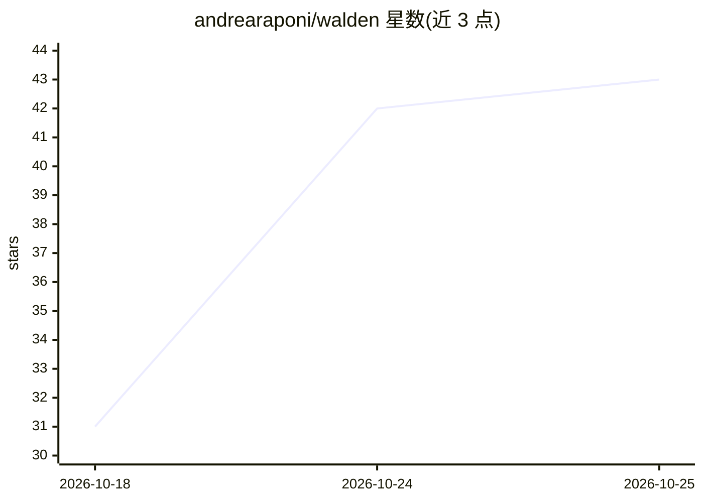

# andrearaponi/walden

⭐ 43 · Go · Apache-2.0 · 推送 2026-10-10 · [GitHub](https://github.com/andrearaponi/walden) · [官网](https://andrearaponi.github.io/walden/) · 个人维护

**面向编码代理的规格驱动交付内核 CLI：从意图到可认证发布**

用 Go 编写的确定性 CLI，将功能开发组织为 Requirements→Design→Tasks→Execute 四阶段门控流程：需求以 EARS 验收标准编写并带稳定 ID，设计须覆盖全部标准，每个叶任务携带可执行验证证明，完成时记录与规格链和代码绑定的持久证据；文档或代码在批准后变更会显现过期状态。AI 技能（npx skills 安装）负责澄清提问、起草文档、规划任务等非确定性部分，并代为调用 CLI；人工保留全部批准权。二进制经 install.sh 或 go install 安装，支持 darwin/linux amd64/arm64，Windows 从源码或发布资产安装。

## 筛选速览

| 维度 | 判定 | 备注 |
|---|---|---|
| AI 角色 | `ai-ecosystem` | LLM/agent 周边工具 |
| 许可风险 | `permissive` | Apache-2.0 |
| 部署形态 | `desktop` | 安装包/桌面程序 |
| 模型依赖 | — | README 未给出锁定关系 |
| 硬件要求 | — | 无带数字的原话,不猜 |
| 安装摩擦 | `low` | 无编译、无系统依赖或容器化 |
| 成熟度 | — | 结构信号不足 |

## 能力要点

- 四阶段门控流程与文档新鲜度指纹、过期检测
- EARS 验收标准全量追溯与每个任务的执行验证证明
- AI 技能起草文档并驱动 CLI，批准权保留给人工
- 纯 Go 标准库实现，零外部依赖

## 适用场景

- 通过 Claude Code / Codex 等编码代理按门控流程交付功能
- 为长周期仓库管理规格组合一致性（walden consolidate）
- 评估既有 Walden 规格的存量采纳（walden adopt）

## 场景标签

 · 领域:软件工程/交付流程

## 证据(README 行号)

> L12: Most teams run Walden through a coding agent. The AI skill handles the non-deterministic half — asking clarifying q
> L138: That's it. The skill asks clarifying questions, drafts requirements in EARS format, designs the architecture, brea

## 星数曲线

2026-10-18 31 → 2026-10-25 43（+12）

---
*卡片 v1 · prompt 1.4 · 生成 2026-10-25 · 置信度 high · 依据 README sha `1a8514350b02` · [字段定义](../../DATASET.md)*
