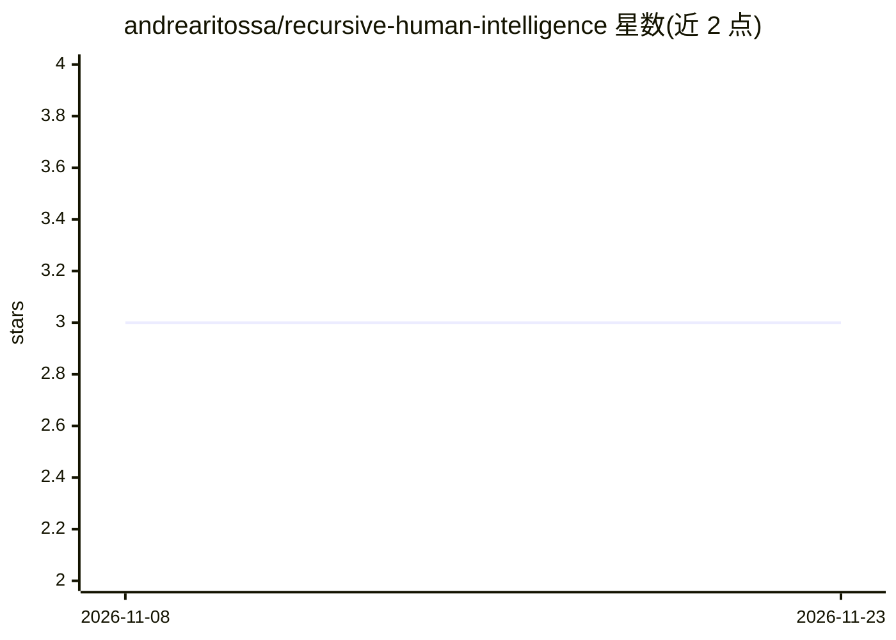

# andrearitossa/recursive-human-intelligence

⭐ 3 · Java · Apache-2.0 · 推送 2026-11-06 · [GitHub](https://github.com/andrearitossa/recursive-human-intelligence) · 个人维护

**把多个 AI 编码代理聚合到一个仪表盘并回读你的聊天给你反馈的桌面应用**

Java/Swing 桌面应用，在本地读取 Claude Code、Codex、ChatGPT 应用、Pi 等编码代理的会话日志，将所有会话聚合到一个每十秒刷新的仪表盘，提供按项目的时间线、置顶、过滤与直接恢复会话的入口。反馈循环将用户请求摘录（每条截断至 1,000 字符）发送到用户自配的 OpenAI/Claude/OpenRouter key，生成习惯模式、学习建议等条目，要求条目引用至少两条真实消息；支持每周定时运行。数据本地存储于 ~/.loop，密钥由系统密钥链加密。安装脚本无需 Java；从源码构建需 JDK 17+。

## 筛选速览

| 维度 | 判定 | 备注 |
|---|---|---|
| AI 角色 | `ai-ecosystem` | LLM/agent 周边工具 |
| 许可风险 | `permissive` | Apache-2.0 |
| 部署形态 | `None` |  |
| 模型依赖 | locked-api |  |
| 硬件要求 | — | 无带数字的原话,不猜 |
| 安装摩擦 | `medium` | 含编译或系统依赖之一 |
| 成熟度 | — | 结构信号不足 |

## 能力要点

- 一个仪表盘聚合本地多个编码代理的会话日志，每 10 秒刷新
- 反馈循环最多十轮迭代，条目必须引用至少两条真实消息
- 三种模型提供方（OpenAI/Claude/OpenRouter）经统一模型接口配置，密钥存入系统密钥链
- 本地保留：转录不改写、凭据先移除、仪表盘不发送数据

## 适用场景

- 同时运行多个编码代理时集中查看哪些会话在等待输入
- 从历史 AI 编码聊天中找出重复提问与可沉淀的习惯
- 按代理与时间过滤浏览各项目的会话时间线

## 场景标签

 · 领域:开发者工具/AI 编码辅助

## 证据(README 行号)

> L7: One window for every coding agent you run (Claude Code, Codex, the ChatGPT app, Pi), then honest feedback on how you
> L33: The **Dashboard** opens first. It reads your agents' session logs on this computer and refreshes every ten seconds.
> L97: Settings supports three providers through one model interface:

## 星数曲线

2026-11-08 3 → 2026-11-23 3（+0）

---
*卡片 v1 · prompt 1.4 · 生成 2026-11-22 · 置信度 high · 依据 README sha `471aa1c064ba` · [字段定义](../../DATASET.md)*
