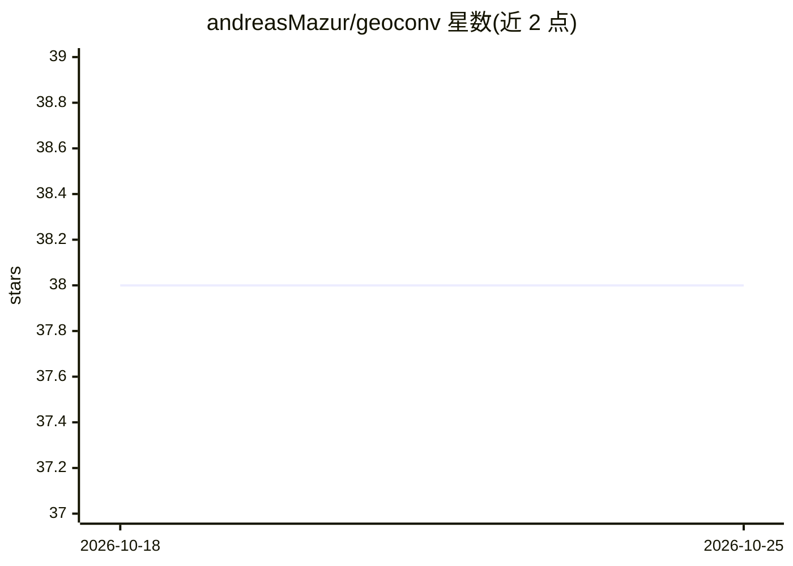

# andreasMazur/geoconv

⭐ 38 · Python · GPL-3.0 · 推送 2026-10-13 · [GitHub](https://github.com/andreasMazur/geoconv) · 个人维护

**三维曲面上做深度学习的 Python 库：网格预处理与表面卷积**

面向曲面几何深度学习的 Python 库：预处理部分基于 Atlas 类，对三角网格计算局部图表、模板顶点与重心坐标，支持 hdf5/npy 存储；网络设计部分基于 ConvBase 类，提供 TensorFlow 与 PyTorch 双后端的多种表面卷积实现（ISC、GCNN、HSN、GEM-CNN、EMAN 及其扩展），并含基准功能。安装需先装 BLAS/CBLAS，pip 安装可选各深度学习后端。定位为促进学术与非商业研究，GPL-3.0 许可，要求引用原始方法论文。

## 筛选速览

| 维度 | 判定 | 备注 |
|---|---|---|
| AI 角色 | `ai-native` | 本体是模型或模型工具 |
| 许可风险 | `viral` | GPL-3.0 |
| 部署形态 | `library` | 以包/库形式分发 |
| 模型依赖 | — | README 未给出锁定关系 |
| 硬件要求 | — | 无带数字的原话,不猜 |
| 安装摩擦 | `medium` | 含编译或系统依赖之一 |
| 成熟度 | — | 结构信号不足 |

## 能力要点

- Atlas 类实现三角网格三步预处理（局部图表/模板顶点/重心坐标）
- 提供 ISC/GCNN/HSN/GEM-CNN/EMAN 等多种表面卷积实现
- 同时支持 TensorFlow 与 PyTorch 后端
- 支持 hdf5/npy 格式的图谱存储与可视化工具

## 适用场景

- 在三角网格数据上构建端到端深度学习流水线
- 对比不同表面卷积方法做基准测试
- 将曲面信号处理研究成果用于学术与非商业研究

## 场景标签

 · 领域:几何深度学习/3D 计算

## 证据(README 行号)

> L11: **GeoConv** is a Python library that provides end-to-end tools for deep learning on curved surfaces in 3D ambient
> L55: using `TensorFlow` or `Pytorch`. Currently, GeoConv provides implementations for the following surface convolutions
> L110: GeoConv provides implementations of- and interfaces to methods from publicly available prior work for computing lo

## 星数曲线

2026-10-18 38 → 2026-10-25 38（+0）

---
*卡片 v1 · prompt 1.4 · 生成 2026-10-25 · 置信度 high · 依据 README sha `745d18663bfb` · [字段定义](../../DATASET.md)*
