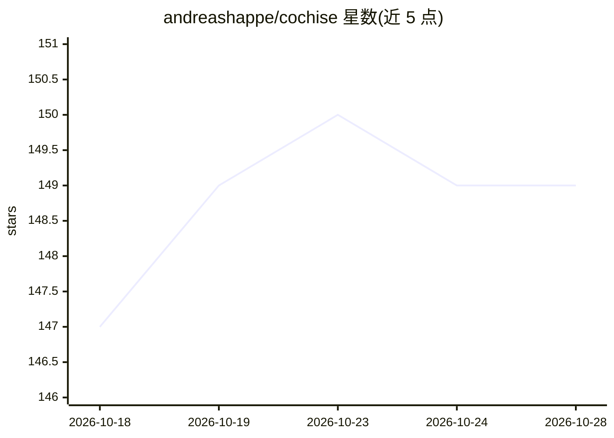

# andreashappe/cochise

⭐ 149 · Python · MIT · 推送 2026-10-24 · [GitHub](https://github.com/andreashappe/cochise) · 个人维护

**LLM 驱动的自主渗透测试原型：攻陷 Active Directory 域**

约 630 行 Python 的最小可读原型，用 LLM 自动对 Active Directory 测试环境执行渗透测试：Planner 维护持久对话生成并更新分层攻击计划，委派短生命周期 Executor 通过 SSH 在攻击机 VM 上执行命令，共享 Knowledge Base 跟踪已攻陷账号与服务。通过 LiteLLM 接入模型，单一环境变量切换并基准测试各 LLM；附带运行回放、分析与 LaTeX 表格导出工具。仅限授权测试环境与学术研究用途。

## 筛选速览

| 维度 | 判定 | 备注 |
|---|---|---|
| AI 角色 | `ai-native` | 本体是模型或模型工具 |
| 许可风险 | `permissive` | MIT |
| 部署形态 | `None` |  |
| 模型依赖 | local-ok | 支持本地模型 |
| 硬件要求 | — | 无带数字的原话,不猜 |
| 安装摩擦 | `low` | 无编译、无系统依赖或容器化 |
| 成熟度 | `idea` | |

## 能力要点

- Planner/Executor/Knowledge Base 三层架构，核心仅约 630 行 Python
- LiteLLM 接入 100+ LLM 提供商，单环境变量换模型做安全能力基准
- 上下文窗口自动压缩，支持数小时连续运行
- 附运行轨迹回放、分析与 LaTeX 表格导出工具

## 适用场景

- 在 GOAD 类测试环境做无人值守的 Active Directory 渗透测试
- 对比不同 LLM 的网络安全攻击能力
- 作为自主攻击 agent 研究的可读基线进行二次开发

## 场景标签

`网络安全` · 领域:学习与行业

## 证据(README 行号)

> L8: Cochise is a minimal, readable prototype that uses LLMs to autonomously pen-test enterprise networks using Microsoft
> L35:                     |     Planner      |  Strategic brain: creates attack plan,
> L40: The **Planner** maintains a persistent conversation with the LLM, building and updating a hierarchical attack plan.

## 星数曲线

2026-10-18 147 → 2026-10-28 149（+2）

---
*卡片 v1 · prompt 1.4 · 生成 2026-10-23 · 置信度 high · 依据 README sha `e8bdc4f70c24` · [字段定义](../../DATASET.md)*
