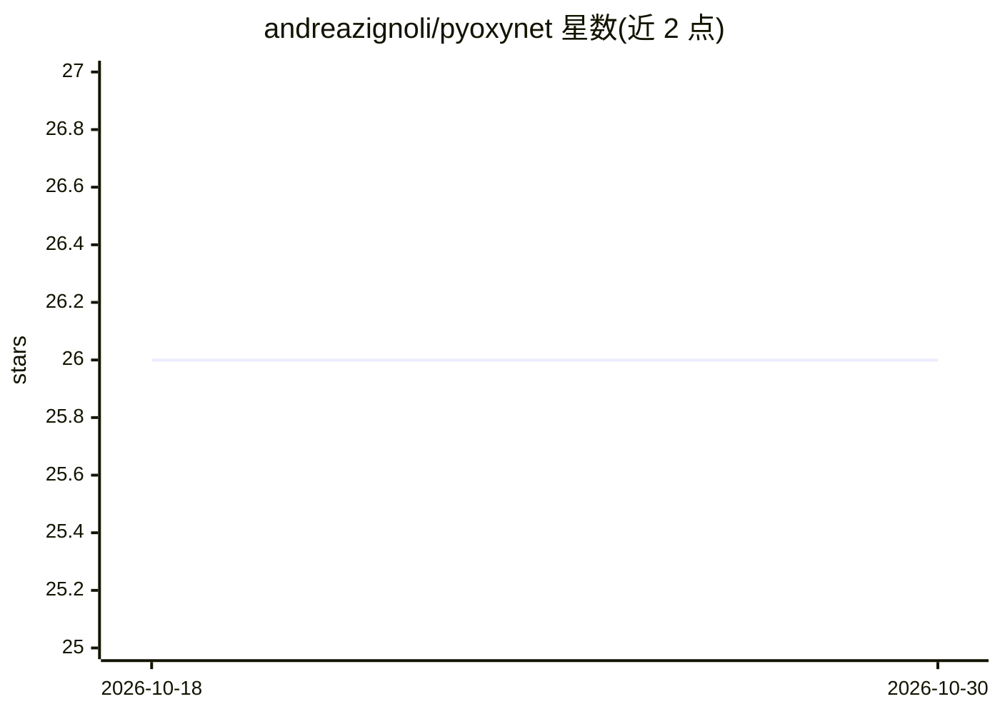

# andreazignoli/pyoxynet

⭐ 26 · Python · MIT · 推送 2026-10-29 · [GitHub](https://github.com/andreazignoli/pyoxynet) · [官网](https://www.oxynet.net) · 个人维护

**基于深度神经网络的 CPET 数据自动分析 Python 库**

Oxynet 项目的开源研究包：提供两类深度学习模型（Keras/TensorFlow 训练，TFLite 推荐推理引擎）——推断模型从心肺运动测试（CPET）数据估计运动强度域，生成模型用条件 GAN 生成合成 CPET 数据。数据需逐秒过采样，支持多种插值处理呼吸逐口或平均数据；无 VCO2 时提供替代输入方案（未发表验证）。面向运动生理与科研用户，提供 pip 安装与部署在 Heroku 的 Flask 推理 API；另有独立的托管平台 app.oxynet.net。声明为研究软件、非诊断设备。

## 筛选速览

| 维度 | 判定 | 备注 |
|---|---|---|
| AI 角色 | `ai-native` | 本体是模型或模型工具 |
| 许可风险 | `permissive` | MIT |
| 部署形态 | `library` | 以包/库形式分发 |
| 模型依赖 | — | README 未给出锁定关系 |
| 硬件要求 | — | 无带数字的原话,不猜 |
| 安装摩擦 | `low` | 无编译、无系统依赖或容器化 |
| 成熟度 | `idea` | |

## 能力要点

- 推断模型从 CPET 数据估计运动强度域
- 条件 GAN 生成合成（假但逼真）CPET 数据
- 自 v0.1.5 起提供 TFLite 轻量推理与三种安装变体
- Flask-Pyoxynet 容器化 API 可通过 JSON/CSV 调用

## 适用场景

- 对心肺运动测试数据自动估计运动强度域
- 生成合成 CPET 数据用于测试或演示
- 通过 REST API 从终端或浏览器调用推断与生成功能

## 场景标签

`科研工具` · 领域:学习与行业

## 证据(README 行号)

> L58: *Pyoxynet* is a collection of algorithms developed in the context of the *Oxynet* project. All the algorithms are c
> L64: * The *inference* model: it takes some CPET data as input and it provides an estimation of the exercise intensity d
> L65: * The *generator* model: it generates new synthetic CPET data

## 星数曲线

2026-10-18 26 → 2026-10-30 26（+0）

---
*卡片 v1 · prompt 1.4 · 生成 2026-10-26 · 置信度 high · 依据 README sha `edd6d8d3a761` · [字段定义](../../DATASET.md)*
