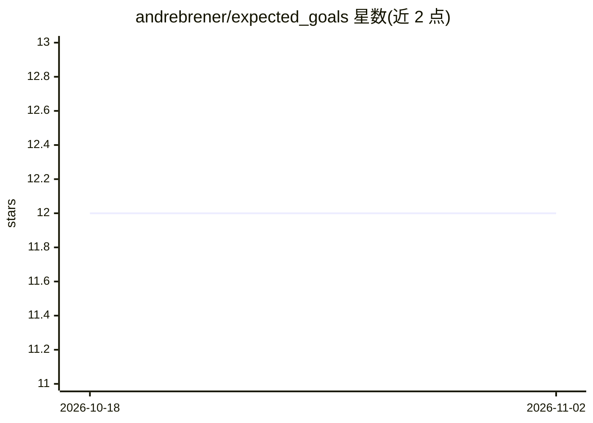

# andrebrener/expected_goals

⭐ 12 · Python · MIT · 推送 2026-06-03 · [GitHub](https://github.com/andrebrener/expected_goals) · 个人维护

**足球射门期望进球(xG)预测的 scikit-learn 流水线**

将 Squawka 射门事件数据转化为期望进球（xG）模型的机器学习流水线：解析原始比赛 HTML 为 CSV，构建射门数据库，经特征工程后用网格搜索训练 RandomForestRegressor，输出各队/各球员的实际进球与 xG 对比及图表。面向做足球数据分析的开发者。属 2016–2017 存档项目：数据爬虫已删除导致前两步无法直接运行，数据源 Squawka 已停服，需自备中间 CSV；仓库含 ~67MB 提交的 pickle 模型，建议自行重新训练。

## 筛选速览

| 维度 | 判定 | 备注 |
|---|---|---|
| AI 角色 | `ai-native` | 本体是模型或模型工具 |
| 许可风险 | `permissive` | MIT |
| 部署形态 | `library` | 以包/库形式分发 |
| 模型依赖 | — | README 未给出锁定关系 |
| 硬件要求 | — | 无带数字的原话,不猜 |
| 安装摩擦 | `low` | 无编译、无系统依赖或容器化 |
| 成熟度 | — | 结构信号不足 |

## 能力要点

- 8 步模块化流水线：数据处理→射门数据库→特征工程→训练→验证→绘图
- RandomForestRegressor 网格搜索训练并 pickle 保存模型
- 输出每队/每球员实际进球 vs xG 的对比 CSV 与图表

## 适用场景

- 基于射门事件数据训练期望进球模型
- 评估球队/球员实际进球与 xG 的差异
- 参考 scikit-learn 体育数据分析流水线的实现方式

## 场景标签

`数据分析` · 领域:效率与自动化

## 证据(README 行号)

> L3: A scikit-learn pipeline that turns Squawka
> L62: 6. `python -m model.xg_model` – train a `RandomForestRegressor` (grid search) and

## 星数曲线

2026-10-18 12 → 2026-11-02 12（+0）

---
*卡片 v1 · prompt 1.4 · 生成 2026-11-01 · 置信度 mid · 依据 README sha `681fe5e7f510` · [字段定义](../../DATASET.md)*
