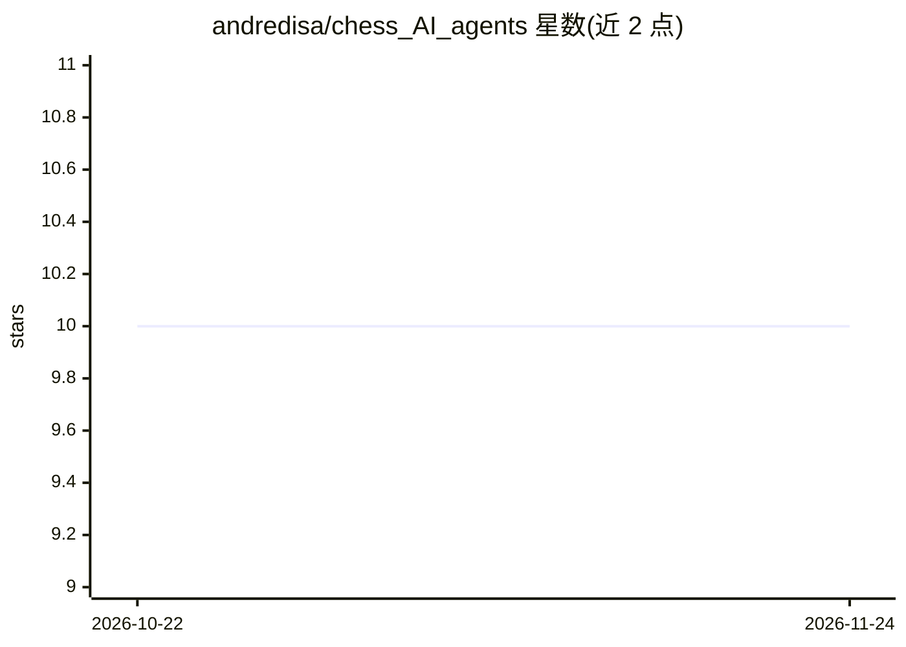

# andredisa/chess_AI_agents

⭐ 10 · Python · MIT · 推送 2026-05-22 · [GitHub](https://github.com/andredisa/chess_AI_agents) · 个人维护

**基于 LLM 双 agent 对弈的 AI 国际象棋观赛应用**

用 Streamlit 构建的网页应用：两个由 OpenAI LLM 驱动的 AutoGen ConversableAgent 分别执白黑双方，Game_Master agent 负责走法校验与对局协调；每步走子后通过 SVG 渲染实时更新棋盘，记录完整走子历史并检测将杀、逼和等终局状态。用户可配置对弈回合数、一键重置，在浏览器中观看两个模型实时对弈。需要 OpenAI API key 与网络连接，当前不支持人机对弈或本地模型。

## 筛选速览

| 维度 | 判定 | 备注 |
|---|---|---|
| AI 角色 | `ai-native` | 本体是模型或模型工具 |
| 许可风险 | `permissive` | MIT |
| 部署形态 | `library` | 以包/库形式分发 |
| 模型依赖 | — | README 未给出锁定关系 |
| 硬件要求 | — | 无带数字的原话,不猜 |
| 安装摩擦 | `low` | 无编译、无系统依赖或容器化 |
| 成熟度 | — | 结构信号不足 |

## 能力要点

- 两个 OpenAI LLM agent 通过 AutoGen 框架自动对弈国际象棋
- SVG 实时渲染棋盘与完整走子历史
- Game_Master agent 负责走法校验与终局检测（将杀/逼和等）
- 回合数可配置，支持完整重置

## 适用场景

- 观看两个大语言模型之间的国际象棋对弈
- 作为 AutoGen 多 agent 协作机制的示例项目进行学习
- 基于其模块化代码扩展人机对弈或本地模型支持

## 场景标签

`多智能体` · 领域:Agent 开发

## 证据(README 行号)

> L3: >Welcome to **chess AI agents** — an interactive AI vs AI chess game built with **Streamlit**, **Python-Chess**, and
> L10: - ✅ Game coordination via AutoGen's ConversableAgent framework
> L52: - Two agents (`Agent_White` and `Agent_Black`) are powered by **OpenAI LLMs** using **AutoGen**.

## 星数曲线

2026-10-22 10 → 2026-11-24 10（+0）

---
*卡片 v1 · prompt 1.4 · 生成 2026-11-20 · 置信度 high · 依据 README sha `d104197761c7` · [字段定义](../../DATASET.md)*
