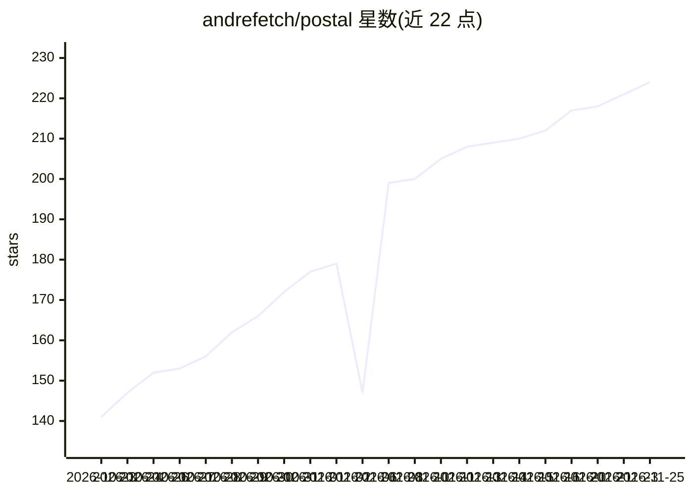

# andrefetch/postal

⭐ 224 · Python · GPL-3.0 · 推送 2026-11-21 · [GitHub](https://github.com/andrefetch/postal) · [官网](https://postalcli.vercel.app) · 个人维护

**终端中的开源异步 AI 编码 agent，读写并审查代码**

Postal 是运行于终端的开源 AI 编码 agent：读取并编辑代码、执行命令、规划变更，并将任务委派给专用子 agent。模型通过 OpenRouter 接入，用户可切换模型并配置哪些操作需要人工批准。以 TUI 形式在项目目录中运行，支持会话恢复、跨目录工作、slash 命令、检查点与 MCP 工具。安装要求 Python 3.11+ 与 Node.js 22+，采用 GPL v3.0 许可。

## 筛选速览

| 维度 | 判定 | 备注 |
|---|---|---|
| AI 角色 | `ai-native` | 本体是模型或模型工具 |
| 许可风险 | `viral` | GPL-3.0 |
| 部署形态 | `library` | 以包/库形式分发 |
| 模型依赖 | locked-api |  |
| 硬件要求 | — | 无带数字的原话,不猜 |
| 安装摩擦 | `low` | 无编译、无系统依赖或容器化 |
| 成熟度 | — | 结构信号不足 |

## 能力要点

- 读取/编辑代码、运行命令并委派任务给子 agent
- 通过 OpenRouter 使用任意模型，可切换模型
- 可配置操作批准策略、会话与检查点
- 支持 MCP 与工具扩展

## 适用场景

- 在终端里让 agent 探索代码库并修复失败的测试
- 规划并审查代码变更
- 异步委派子 agent 处理编码任务

## 场景标签

`编码 Agent` · 领域:编码与开发

## 证据(README 行号)

> L3:  An open-source alternative AI coding agent that lives in your terminal.
> L8: Postal reads and edits your code, runs commands, and delegates tasks to specialized sub-agents. Choose your model th

## 星数曲线

2026-10-23 141 → 2026-11-25 224（+83）

---
*卡片 v1 · prompt 1.4 · 生成 2026-11-25 · 置信度 high · 依据 README sha `3011a54c7a1c` · [字段定义](../../DATASET.md)*
