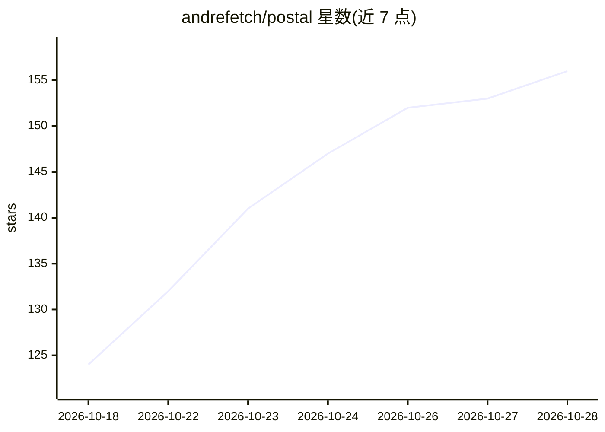

# andrefetch/postal

⭐ 156 · Python · GPL-3.0 · 推送 2026-10-25 · [GitHub](https://github.com/andrefetch/postal) · [官网](https://postalcli.vercel.app) · 个人维护

**终端 AI 编程 agent：通过 OpenRouter 调任意模型读写代码**

基于 Python 的开源终端 AI 编程 agent，经 OpenRouter 连接 Claude、OpenAI、DeepSeek 等模型，内置文件读写、bash 执行、规划、网络搜索、MCP 连接与五个专职子代理，运行在全屏 TUI 中并流式输出。提供六级审批策略、危险命令拒绝与工作目录外操作确认；上下文满时压缩历史续跑，会话每轮落盘可 checkpoint 回滚。作者声明其亦作为可拆解学习的教学性代码库，欢迎改造扩展。

## 筛选速览

| 维度 | 判定 | 备注 |
|---|---|---|
| AI 角色 | `ai-native` | 本体是模型或模型工具 |
| 许可风险 | `viral` | GPL-3.0 |
| 部署形态 | `library` | 以包/库形式分发 |
| 模型依赖 | locked-api |  |
| 硬件要求 | — | 无带数字的原话,不猜 |
| 安装摩擦 | `low` | 无编译、无系统依赖或容器化 |
| 成熟度 | — | 结构信号不足 |

## 能力要点

- OpenRouter 单点接入多模型（Claude/OpenAI/DeepSeek/Kimi 等）
- 六级审批策略与危险命令模式拒绝
- 上下文修剪与历史压缩以维持长会话
- 会话 checkpoint 与 /rewind 回滚（仅回滚对话不改文件）
- 五个专职子代理与 MCP 外部工具连接

## 适用场景

- 在终端用自然语言让 AI 探索、修改、评审代码库
- 按可控风险级别自动化执行重构、测试修复等任务
- 学习 AI coding agent 的 harness 架构并自行改造扩展

## 场景标签

`编码 Agent` · 领域:编码与开发

## 证据(README 行号)

> L3:  An open-source AI coding agent that lives in your terminal.
> L8: Postal connects to LLMs through OpenRouter, reads and edits your code with a built-in tool set, runs shell commands,

## 星数曲线

2026-10-18 124 → 2026-10-28 156（+32）

---
*卡片 v1 · prompt 1.4 · 生成 2026-10-23 · 置信度 high · 依据 README sha `14693c5db92f` · [字段定义](../../DATASET.md)*
