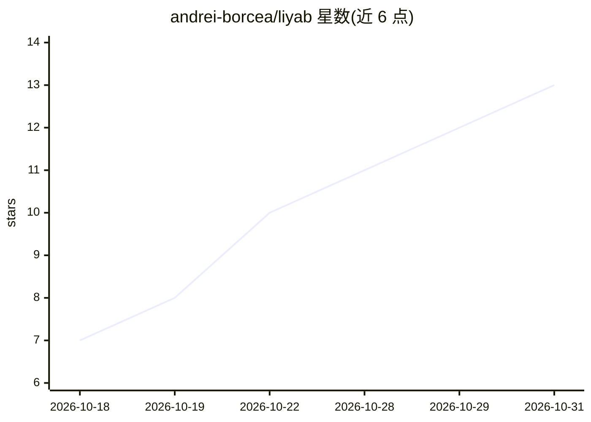

# andrei-borcea/liyab

⭐ 13 · C++ · Apache-2.0 · 推送 2026-10-30 · [GitHub](https://github.com/andrei-borcea/liyab) · 个人维护

**手机端运行超大 GGUF 模型的 C++ 推理引擎与本地助手**

C++20 编写的 GGUF 推理引擎，支持稠密、MoE、循环与稀疏注意力架构，可从闪存流式加载超过内存容量的模型权重，并按设备温度预测调节生成节奏。覆盖 Android/iOS/macOS/Linux，计算后端含 ARM NEON/AVX2/Metal/Vulkan。附带 Flutter 私有端侧助手（聊天、工具、模型下载）与本地 OpenAI/Anthropic/gRPC API。iOS/Linux/Windows 平台仍标注未完成验证，需从源码编译构建。

## 筛选速览

| 维度 | 判定 | 备注 |
|---|---|---|
| AI 角色 | `ai-ecosystem` | LLM/agent 周边工具 |
| 许可风险 | `permissive` | Apache-2.0 |
| 部署形态 | `None` |  |
| 模型依赖 | — | README 未给出锁定关系 |
| 硬件要求 | — | 无带数字的原话,不猜 |
| 安装摩擦 | `high` | 编译与系统依赖俱全 |
| 成熟度 | `idea` | |

## 能力要点

- 超过 RAM 的模型通过闪存流式加载（稠密块流水线 + MoE 专家缓存）
- 温度感知的 token 调速与性能/均衡/低功耗档位
- 本地 OpenAI / Anthropic Messages / gRPC API，默认关闭、仅回环监听
- 66 个架构测试配方，覆盖 Llama/Qwen/MoE/Mamba/DeepSeek 等家族

## 适用场景

- 在手机上运行超过设备内存的大模型且保持隐私本地推理
- 把手机上的模型通过本地 API 提供给其他应用调用
- 嵌入/重排/LoRA 适配等本地推理任务

## 场景标签

`推理引擎` `AI 助手` · 领域:对话与助手

## 证据(README 行号)

> L11: C++20 inference engine for GGUF models, with a Flutter assistant for Android and macOS.
> L22: |Inference|GGUF v2/v3, split files, 26 weight formats; dense, MoE, recurrent and latent/sparse attention paths|
> L29: |Local API|OpenAI, Anthropic Messages and gRPC; loopback, token authentication, off by default|

## 星数曲线

2026-10-18 7 → 2026-10-31 13（+6）

---
*卡片 v1 · prompt 1.4 · 生成 2026-10-31 · 置信度 high · 依据 README sha `1b55407aae65` · [字段定义](../../DATASET.md)*
