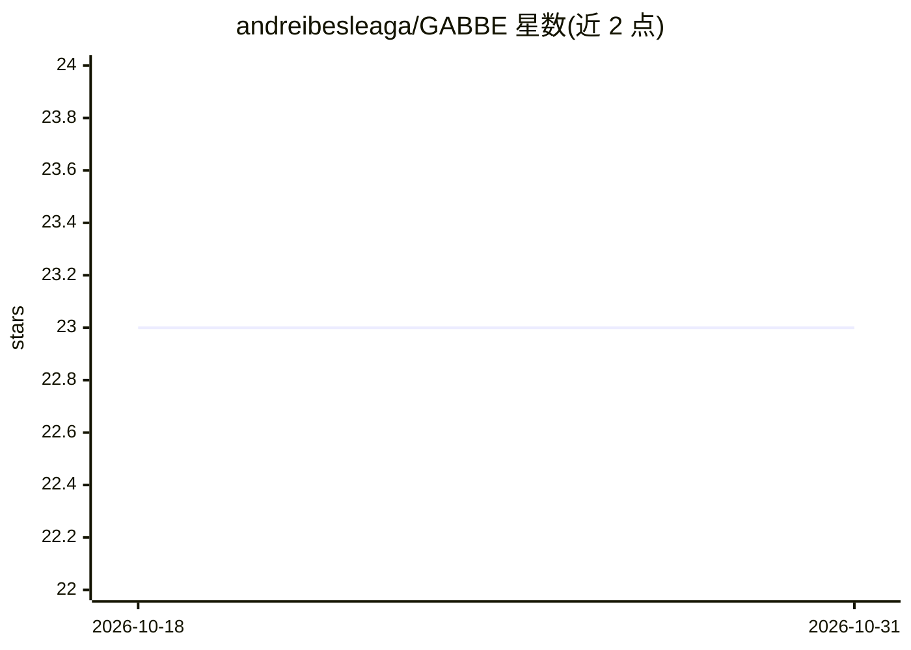

# andreibesleaga/GABBE

⭐ 23 · Python · NOASSERTION · 推送 2026-10-30 · [GitHub](https://github.com/andreibesleaga/GABBE) · [官网](https://andreibesleaga.github.io/GABBE/) · 个人维护

**面向 AI 编码 agent 的软件工程治理套件（技能/模板/多代理团队）**

为各类 AI 编码代理（Claude Code、Cursor、Copilot 等）提供 drop-in 上下文套件：214 个技能、100 个模板、86 个指南、36 个角色与 50+ MCP 服务器配置，将代理组织为受治理的工程团队。含实验性元认知编排 Brain 模式与 30+ 角色的 Loki 多代理蜂群，覆盖 S00–S13 全生命周期门控、预算执行与审计跟踪。通过 npx/pipx/curl/git 一条命令安装，跨平台支持 Linux/macOS/WSL/Windows。

## 筛选速览

| 维度 | 判定 | 备注 |
|---|---|---|
| AI 角色 | `ai-ecosystem` | LLM/agent 周边工具 |
| 许可风险 | `none` | NOASSERTION |
| 部署形态 | `library` | 以包/库形式分发 |
| 模型依赖 | — | README 未给出锁定关系 |
| 硬件要求 | — | 无带数字的原话,不猜 |
| 安装摩擦 | `low` | 无编译、无系统依赖或容器化 |
| 成熟度 | `idea` | |

## 能力要点

- 214 技能 + 100 模板 + 86 指南 + 36 角色 + 50+ MCP 服务器配置
- 通用技能编译器：一次编写，为各 AI 工具生成对应格式（.mdc/.SKILL.md/.agents 等）
- Brain 元认知编排与 Loki 多代理蜂群（30+ 角色）
- 可作为 Claude Code 插件市场条目安装

## 适用场景

- 把我的 AI 编码代理纳入有治理门控的软件开发生命周期
- 在多个编码代理工具间共享同一套工程技能与规范
- 大型项目中以多代理角色分工执行开发任务

## 场景标签

`Agent 框架` `多智能体` · 领域:Agent 开发

## 证据(README 行号)

> L13: - Drop-in context kit that turns any AI coding agent into a governed engineering team for developing software.
> L16: - **Write Once, Run Everywhere**: SKILLS for Cursor (`.mdc`), VS Code / Copilot (`folder/SKILL.md`), Claude (`.clau
> L80: The installer is a **Universal Skill Compiler** — it generates the correct format for each AI tool:

## 星数曲线

2026-10-18 23 → 2026-10-31 23（+0）

---
*卡片 v1 · prompt 1.4 · 生成 2026-10-27 · 置信度 high · 依据 README sha `db35aeb60bf8` · [字段定义](../../DATASET.md)*
