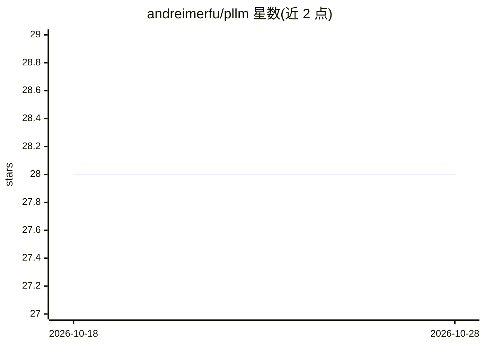

# andreimerfu/pllm

⭐ 28 · Go · MIT · 推送 2026-06-26 · [GitHub](https://github.com/andreimerfu/pllm) · [官网](https://pllm.dev) · 个人维护

**Go 编写的 LLM 网关：多提供商路由、故障转移与负载均衡**

位于应用与 LLM 提供商之间的 OpenAI 兼容代理网关，用 Go 实现。应用将 OpenAI SDK 的 base_url 指向 pLLM 即可接入，无需改代码。核心机制是 Routes 虚拟模型端点，支持 priority/least-latency/weighted-round-robin/random 四种路由策略与三级故障转移；多 key 负载均衡可提升吞吐。提供商覆盖 OpenAI、Anthropic、Azure OpenAI、AWS Bedrock、Vertex AI、Grok、Cohere。功能含 JWT 认证、速率限制、预算管理、Prometheus 指标、OpenTelemetry 追踪与管理面板。提供 Docker Compose、独立 Docker、Helm 与本地开发（需 Go 1.23+、Node.js、PostgreSQL、Redis）多种部署方式。MIT 许可。

## 筛选速览

| 维度 | 判定 | 备注 |
|---|---|---|
| AI 角色 | `ai-ecosystem` | LLM/agent 周边工具 |
| 许可风险 | `permissive` | MIT |
| 部署形态 | `self-host` | docker 或自建部署 |
| 模型依赖 | locked-api |  |
| 硬件要求 | — | 无带数字的原话,不猜 |
| 安装摩擦 | `low` | 无编译、无系统依赖或容器化 |
| 成熟度 | — | 结构信号不足 |

## 能力要点

- OpenAI 兼容 API，改 base_url 即接入，零代码改动
- Routes 虚拟模型端点 + 4 种路由策略 + 3 级故障转移
- 多 key/多部署负载均衡突破单一 API key 速率限制
- JWT 认证、速率限制、预算管理、Prometheus 指标与 OpenTelemetry 追踪

## 适用场景

- 现有 OpenAI SDK 应用不改代码即可切换/聚合多家 LLM 提供商
- 提供商故障时自动切换备用模型，维持服务可用性
- 按优先级或权重在多提供商/多 key 间分摊流量与成本
- 在 Kubernetes 上以 Helm 部署并接入 Prometheus 监控

## 场景标签

`模型网关` · 领域:Agent 开发

## 证据(README 行号)

> L19: pLLM is an LLM gateway that sits between your application and LLM providers. Instead of hardcoding a single provide
> L32: |**Multi-provider**|OpenAI, Anthropic, Azure OpenAI, AWS Bedrock, Google Vertex AI, Grok, Cohere — all behind one e

## 星数曲线

2026-10-18 28 → 2026-10-28 28（+0）

---
*卡片 v1 · prompt 1.4 · 生成 2026-10-26 · 置信度 high · 依据 README sha `26d5e0b0536d` · [字段定义](../../DATASET.md)*
