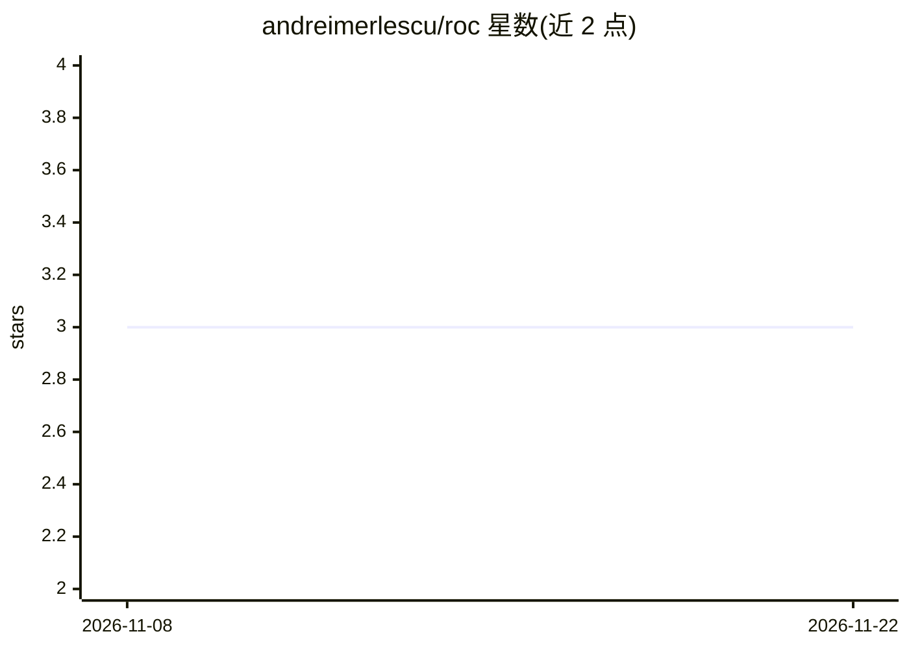

# andreimerlescu/roc

⭐ — · [GitHub]() · 个人维护

**让编码 agent 在一次性 Docker 容器内无审批运行的 Rust CLI**

roc 是一个 Rust 命令行工具，把 opencode、Claude Code、Codex 或 goose 运行在一次性 Docker 容器中：仅挂载用户指定的文件夹（只读挂载由内核强制），容器内关闭审批提示，会话结束时自动清理容器、镜像、网络等资源。通过 MCP 网关向 agent 提供 Docker、数据库、语言服务器、浏览器等工具，密钥保留在宿主机。支持从 LM Studio、Ollama 或任意 OpenAI 兼容 API 的模型 worker 池租借并发会话。需 Docker 与 Rust 1.85+ 构建，退出时未隔离网络。

## 筛选速览

| 维度 | 判定 | 备注 |
|---|---|---|
| AI 角色 | `ai-ecosystem` | LLM/agent 周边工具 |
| 许可风险 | `permissive` | — |
| 部署形态 | `self-host` | docker 或自建部署 |
| 模型依赖 | local-ok | 支持本地模型 |
| 硬件要求 | — | 无带数字的原话,不猜 |
| 安装摩擦 | `low` | 无编译、无系统依赖或容器化 |
| 成熟度 | — | 结构信号不足 |

## 能力要点

- 内核级只读挂载，禁止挂载家目录、~/.ssh、云凭证与 Docker socket
- 会话资源（容器/镜像/网络）记录于状态文件并在退出时清理，崩溃后也可清理
- 通过 MCP 网关提供 22 个服务器目录与 data/research/github/frontend 等 stack
- 模型 worker 池支持多会话并行（roc -ps / roc -kill）

## 适用场景

- 后端开发中让 agent 自行启动 Postgres/Redis 并跑集成测试
- 不给 agent 宿主 Docker socket 的前提下提供受限 Docker 工具
- 多会话并行运行多个编码 agent

## 场景标签

`编码 Agent` · 领域:编码与开发

## 证据(README 行号)

> L5: roc runs opencode, Claude Code,
> L32: roc replaces permission lists with hard walls, and then takes the leash off:
> L96: You need Docker (Desktop, OrbStack or Engine), Rust 1.85+ to build roc, and either a model

## 星数曲线

2026-11-08 3 → 2026-11-22 3（+0）

---
*卡片 v1 · prompt 1.4 · 生成 2026-11-22 · 置信度 mid · 依据 README sha `22cbb2e65698` · [字段定义](../../DATASET.md)*
