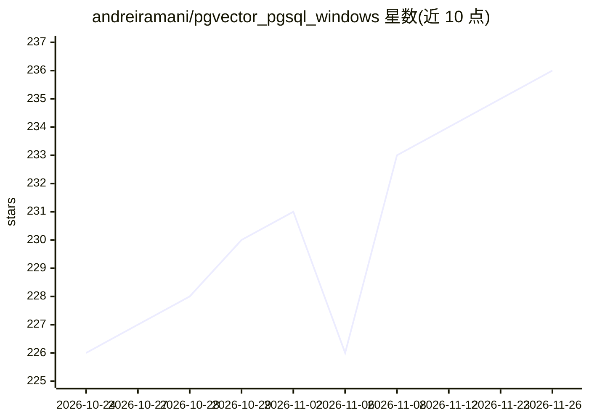

# andreiramani/pgvector_pgsql_windows

⭐ 236 · 推送 2026-11-25 · [GitHub](https://github.com/andreiramani/pgvector_pgsql_windows) · 个人维护

**为 Windows 版 PostgreSQL 提供原生编译的 pgvector 扩展二进制**

面向在 Windows x64 环境运行 PostgreSQL 的用户，提供 pgvector 扩展的非官方预编译二进制发布，免去自行在 Windows 下编译的步骤。安装方式为将 zip 包解压到 PostgreSQL 安装目录的 share\extension\ 下，再通过 CREATE EXTENSION vector 激活，README 附带验证扩展是否启用的 SQL 查询。不同版本（v0.7.x 与 v0.8.x）安装说明不同，具体用法需查阅随附 readme.txt 与 wiki；仓库声明为非官方发布。

## 筛选速览

| 维度 | 判定 | 备注 |
|---|---|---|
| AI 角色 | `ai-enhanced` | 去掉 AI 部分产品仍成立 |
| 许可风险 | `none` | — |
| 部署形态 | `None` |  |
| 模型依赖 | — | README 未给出锁定关系 |
| 硬件要求 | — | 无带数字的原话,不猜 |
| 安装摩擦 | `low` | 无编译、无系统依赖或容器化 |
| 成熟度 | `idea` | |

## 能力要点

- 提供 pgvector 在 Windows x64 下的预编译二进制（非官方发布）
- zip 解压到 PostgreSQL share\extension 目录即可安装
- 提供 SQL 查询验证扩展启用状态
- 覆盖 v0.7.3 至 v0.8.x 多个版本

## 适用场景

- 在 Windows 上为 PostgreSQL 启用向量类型与相似度搜索
- 为本地 RAG 应用的向量存储做准备
- 避免在 Windows 环境自行编译 pgvector 源码

## 场景标签

`向量数据库` · 领域:知识与检索

## 证据(README 行号)

> L1: # pgvector binary compile, Microsoft Windows x64, PostgreSQL
> L16: 2. Activate extension with <code>create extension vector</code>

## 星数曲线

2026-10-24 226 → 2026-11-26 236（+10）

---
*卡片 v1 · prompt 1.4 · 生成 2026-11-26 · 置信度 mid · 依据 README sha `eee02f16b665` · [字段定义](../../DATASET.md)*
