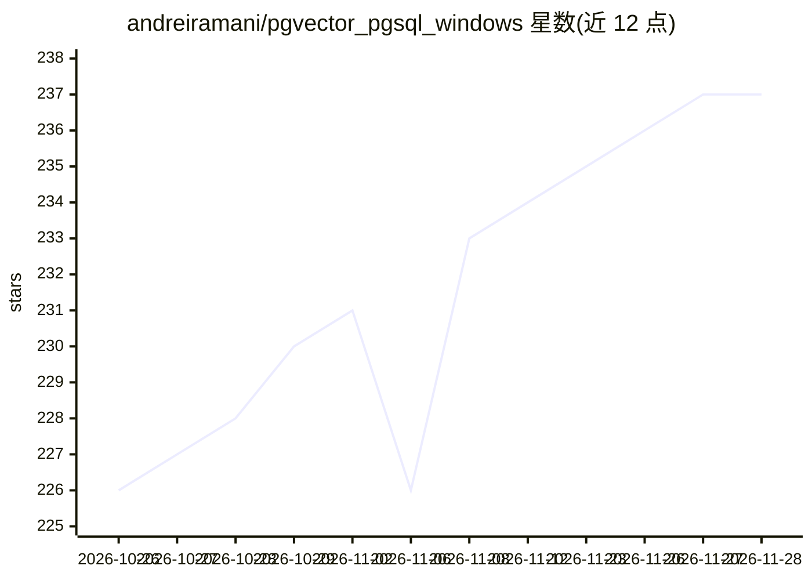

# andreiramani/pgvector_pgsql_windows

⭐ 237 · 推送 2026-11-27 · [GitHub](https://github.com/andreiramani/pgvector_pgsql_windows) · 个人维护

**PostgreSQL pgvector 扩展的 Windows x64 预编译二进制发布**

为 Windows x64 环境下原生编译的 pgvector 扩展提供二进制发布，用户从 GitHub Releases 下载对应版本后解压到 PostgreSQL 的 share/extension 目录，执行 CREATE EXTENSION vector 启用；支持通过 ALTER EXTENSION vector UPDATE 完成版本升级，并可查询 pg_extension 表核对当前版本。README 声明为非官方发布，具体安装细节存放在压缩包内的 readme.txt 中，页面本身信息较简略。

## 筛选速览

| 维度 | 判定 | 备注 |
|---|---|---|
| AI 角色 | `ai-ecosystem` | LLM/agent 周边工具 |
| 许可风险 | `none` | — |
| 部署形态 | `None` |  |
| 模型依赖 | — | README 未给出锁定关系 |
| 硬件要求 | — | 无带数字的原话,不猜 |
| 安装摩擦 | `low` | 无编译、无系统依赖或容器化 |
| 成熟度 | — | 结构信号不足 |

## 能力要点

- 提供 pgvector 在 Windows x64 下的原生编译二进制
- 支持 ALTER EXTENSION 语句升级扩展版本
- 覆盖 v0.7.3 至 v0.8.7 多个版本的发布

## 适用场景

- 在 Windows 环境的 PostgreSQL 中启用向量扩展以存储与检索向量
- RAG 应用中为 PostgreSQL 增加近似最近邻检索能力
- 升级已安装的 pgvector 扩展到新版本

## 场景标签

`向量数据库` · 领域:知识与检索

## 证据(README 行号)

> L1: # pgvector binary compile, Microsoft Windows x64, PostgreSQL
> L31: 1. Extract the zip file to `[pg_installed folder]\share\extension\`.
> L35:    CREATE EXTENSION vector;

## 星数曲线

2026-10-26 226 → 2026-11-28 237（+11）

---
*卡片 v1 · prompt 1.4 · 生成 2026-11-28 · 置信度 mid · 依据 README sha `a05782bf20bf` · [字段定义](../../DATASET.md)*
