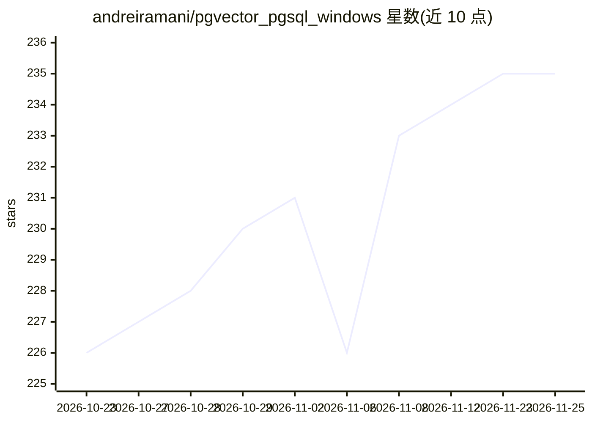

# andreiramani/pgvector_pgsql_windows

⭐ 235 · 推送 2026-11-04 · [GitHub](https://github.com/andreiramani/pgvector_pgsql_windows) · 个人维护

**为 Windows x64 用户提供预编译 pgvector 扩展安装包**

该项目分发在 Microsoft Windows x64 环境下原生编译的 pgvector 二进制文件，属非官方发布。用户从 releases 下载对应版本压缩包，按 wiki 指引操作：v0.8.x 需查阅压缩包内 readme.txt；v0.7.3/v0.7.4 将 zip 解压到 PostgreSQL 安装目录的 share\extension\ 下，执行 create extension vector 激活，并通过查询 pg_extension 确认启用。编译贡献者为 vjivandro（v0.7.3–v0.7.4）与 andreiramani（v0.8.0–v0.8.7）。

## 筛选速览

| 维度 | 判定 | 备注 |
|---|---|---|
| AI 角色 | `ai-ecosystem` | LLM/agent 周边工具 |
| 许可风险 | `none` | — |
| 部署形态 | `None` |  |
| 模型依赖 | — | README 未给出锁定关系 |
| 硬件要求 | — | 无带数字的原话,不猜 |
| 安装摩擦 | `low` | 无编译、无系统依赖或容器化 |
| 成熟度 | — | 结构信号不足 |

## 能力要点

- 提供 Windows x64 原生编译的 pgvector 二进制发布
- v0.7.x/v0.8.x 多版本 releases 可供下载
- 附 wiki 与安装验证 SQL 示例

## 适用场景

- 在 Windows 环境的 PostgreSQL 中启用 pgvector 向量扩展
- 为 RAG 或向量检索场景准备 PostgreSQL 向量存储能力

## 场景标签

`向量数据库` · 领域:知识与检索

## 证据(README 行号)

> L1: # pgvector binary compile, Microsoft Windows x64, PostgreSQL
> L4:  ***** Unofficial release *****
> L16: 2. Activate extension with <code>create extension vector</code>

## 星数曲线

2026-10-23 226 → 2026-11-25 235（+9）

---
*卡片 v1 · prompt 1.4 · 生成 2026-11-25 · 置信度 mid · 依据 README sha `f9db3122f0cf` · [字段定义](../../DATASET.md)*
