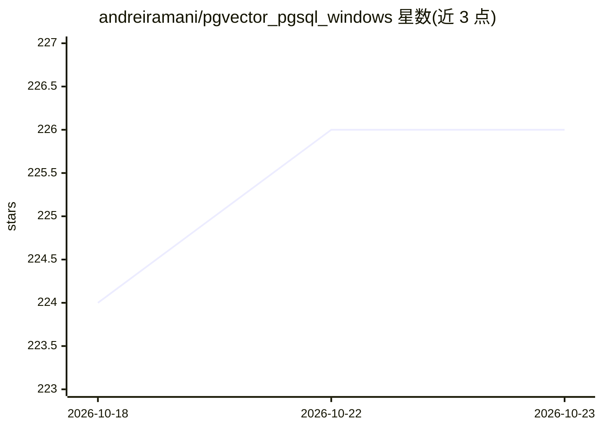

# andreiramani/pgvector_pgsql_windows

⭐ 226 · 推送 2026-10-21 · [GitHub](https://github.com/andreiramani/pgvector_pgsql_windows) · 个人维护

**pgvector 的 Windows 原生编译二进制分发仓库**

非官方发布仓库，提供在 Microsoft Windows 环境下原生编译的 pgvector 扩展二进制（覆盖 v0.7.3 至 v0.8.7 版本，由贡献者 vjivandro 与 andreiramani 编译）。用户从 releases 获取对应版本压缩包，解压到 PostgreSQL 安装目录的 share\extension 文件夹，随后在数据库中执行 create extension vector 启用扩展，并通过查询 pg_extension 验证安装状态。面向在 Windows 上使用 PostgreSQL 并需要向量检索能力的用户，具体说明见仓库 wiki 与压缩包内 readme.txt。

## 筛选速览

| 维度 | 判定 | 备注 |
|---|---|---|
| AI 角色 | `ai-ecosystem` | LLM/agent 周边工具 |
| 许可风险 | `none` | — |
| 部署形态 | `None` |  |
| 模型依赖 | — | README 未给出锁定关系 |
| 硬件要求 | — | 无带数字的原话,不猜 |
| 安装摩擦 | `low` | 无编译、无系统依赖或容器化 |
| 成熟度 | — | 结构信号不足 |

## 能力要点

- 提供 Windows x64 原生编译的 pgvector 扩展二进制
- 覆盖 v0.7.3/v0.7.4 与 v0.8.x 系列版本
- 安装方式为解压至 share\extension 后执行 create extension vector

## 适用场景

- 在 Windows 版 PostgreSQL 上启用向量相似度检索扩展
- RAG 或向量检索场景中免去自行编译 pgvector
- 通过 pg_extension 查询确认扩展启用状态

## 场景标签

`向量数据库` · 领域:知识与检索

## 证据(README 行号)

> L1: # pgvector binary compile, Microsoft Windows x64, PostgreSQL
> L4:  ***** Unofficial release *****

## 星数曲线

2026-10-18 224 → 2026-10-23 226（+2）

---
*卡片 v1 · prompt 1.4 · 生成 2026-10-22 · 置信度 mid · 依据 README sha `c4837af699b1` · [字段定义](../../DATASET.md)*
