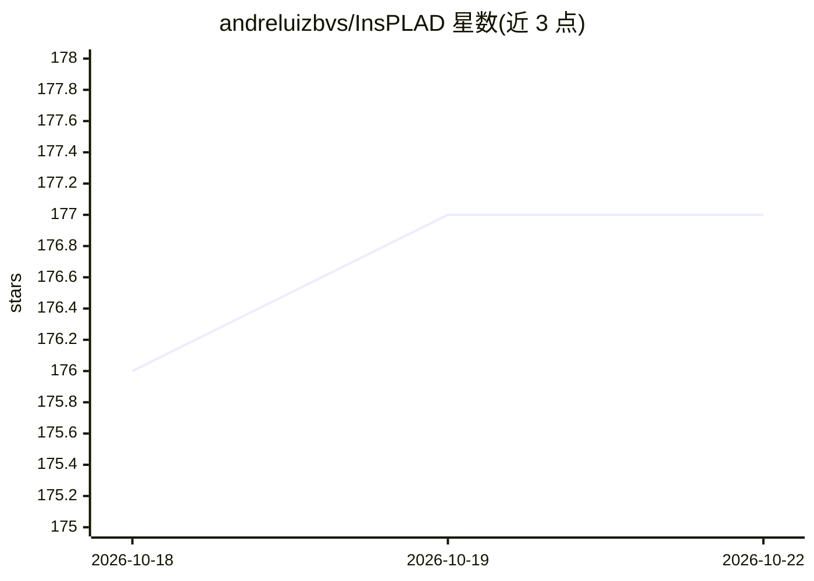

# andreluizbvs/InsPLAD

⭐ 177 · NOASSERTION · 推送 2026-08-04 · [GitHub](https://github.com/andreluizbvs/InsPLAD) · [官网](https://andreluizbvs.github.io/InsPLAD/) · 组织维护

**电力线部件巡检无人机图像数据集与基准（1 万余张）**

InsPLAD 是面向电力线部件巡检的无人机彩色图像数据集与基准，含 10,607 张高分辨率图像、17 类真实运行电力线部件，覆盖目标检测（28,933 实例）、监督缺陷分类（5 类部件、锈蚀/断裂/鸟巢等缺陷）与无监督异常检测三个子数据集，并以 AP、Balanced Accuracy、AUROC 指标评测多种方法。数据集托管于 Mendeley Data，另在 Roboflow 上开始了像素级标注的实例分割项目。面向计算机视觉与电力巡检方向的科研用户。

## 筛选速览

| 维度 | 判定 | 备注 |
|---|---|---|
| AI 角色 | `ai-knowledge` | 知识聚合/清单类 |
| 许可风险 | `none` | NOASSERTION |
| 部署形态 | `None` |  |
| 模型依赖 | — | README 未给出锁定关系 |
| 硬件要求 | — | 无带数字的原话,不猜 |
| 安装摩擦 | `low` | 无编译、无系统依赖或容器化 |
| 成熟度 | — | 结构信号不足 |

## 能力要点

- 10,607 张无人机图像、17 类电力线部件
- 三个子数据集：目标检测/监督缺陷分类/无监督异常检测
- 五类部件含六种缺陷（四种锈蚀、断裂、鸟巢）
- 论文发表于 IJRS 与 WACV2024

## 适用场景

- 训练与评测电力线部件检测模型
- 做工业巡检缺陷分类或异常检测研究
- 开展实例分割标注扩展实验

## 场景标签

`模型评测` `目标检测` · 领域:评测与运维

## 证据(README 行号)

> L3: This repository stores InsPLAD, a dataset introduced in "_InsPLAD: A Dataset and Benchmark for Power Line Asset Insp
> L7: Power line maintenance and inspection are essential to avoid power supply interruptions, reducing its high social an

## 星数曲线

2026-10-18 176 → 2026-10-22 177（+1）

---
*卡片 v1 · prompt 1.4 · 生成 2026-10-22 · 置信度 high · 依据 README sha `4e402637ae2e` · [字段定义](../../DATASET.md)*
