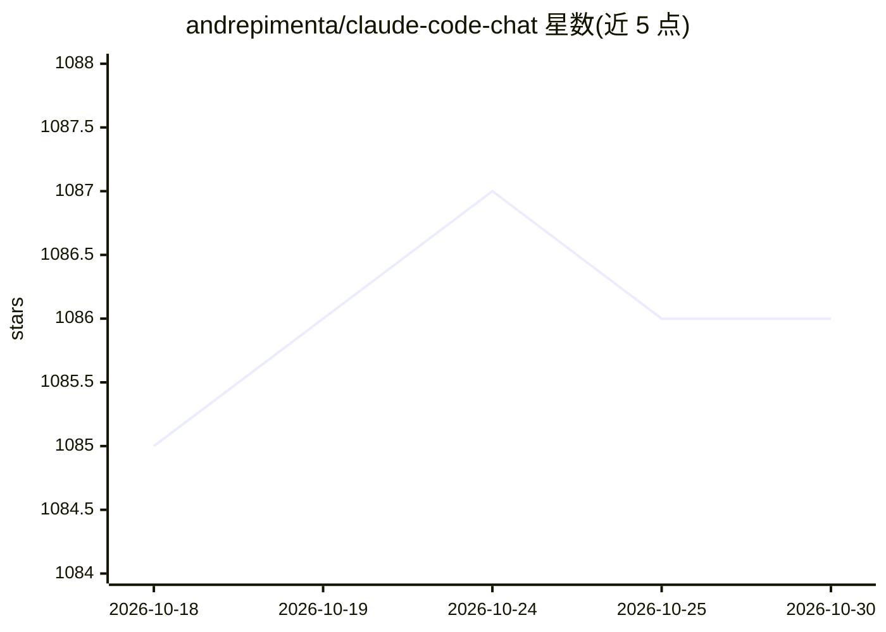

# andrepimenta/claude-code-chat

⭐ 1,086 · JavaScript · NOASSERTION · 推送 2026-09-18 · [GitHub](https://github.com/andrepimenta/claude-code-chat) · [官网](https://marketplace.visualstudio.com/items?itemName=AndrePimenta.claude-code-chat) · 个人维护

**VS Code 扩展：为 Claude Code 提供图形化聊天界面**

TypeScript 编写的 VS Code 扩展，为 Claude Code CLI 提供替代终端的聊天界面：流式回复、内联 diff 查看、基于 Git 的检查点恢复、会话历史、MCP/技能/插件市场浏览与一键安装。支持 Plan First 与多级 Thinking 模式、@文件引用与图片粘贴、权限管理（含 YOLO 模式）。需先安装 Claude Code CLI 与 VS Code 1.80+，通过 VS Code Marketplace 或 .vsix 安装，兼容 Cursor，支持 Windows/WSL。

## 筛选速览

| 维度 | 判定 | 备注 |
|---|---|---|
| AI 角色 | `ai-ecosystem` | LLM/agent 周边工具 |
| 许可风险 | `none` | NOASSERTION |
| 部署形态 | `library` | 以包/库形式分发 |
| 模型依赖 | locked-api |  |
| 硬件要求 | — | 无带数字的原话,不猜 |
| 安装摩擦 | `low` | 无编译、无系统依赖或容器化 |
| 成熟度 | — | 结构信号不足 |

## 能力要点

- 图形化聊天界面替代终端操作 Claude Code，含流式回复与内联 diff
- Git 检查点系统：变更前自动创建还原点，可一键回滚
- MCP/技能/插件市场：浏览 30+ MCP 服务器并一键安装
- Plan First 与多级 Thinking（Think 到 Ultrathink）模式切换

## 适用场景

- 在编辑器内以对话方式使用 Claude Code 进行代码审查、重构与调试
- 实验性修改前创建检查点，失败时一键恢复代码状态
- 在 VS Code 内浏览并安装 MCP 服务器与技能插件

## 场景标签

`编码 Agent` · 领域:编码与开发

## 证据(README 行号)

> L7: > **No more terminal commands. Chat with Claude Code through a beautiful, intuitive interface right inside VS Code.*
> L129: - **Claude Code CLI** - Install from Anthropic

## 星数曲线

2026-10-18 1,085 → 2026-10-30 1,086（+1）

---
*卡片 v1 · prompt 1.4 · 生成 2026-10-21 · 置信度 mid · 依据 README sha `282f4c4cf87c` · [字段定义](../../DATASET.md)*
