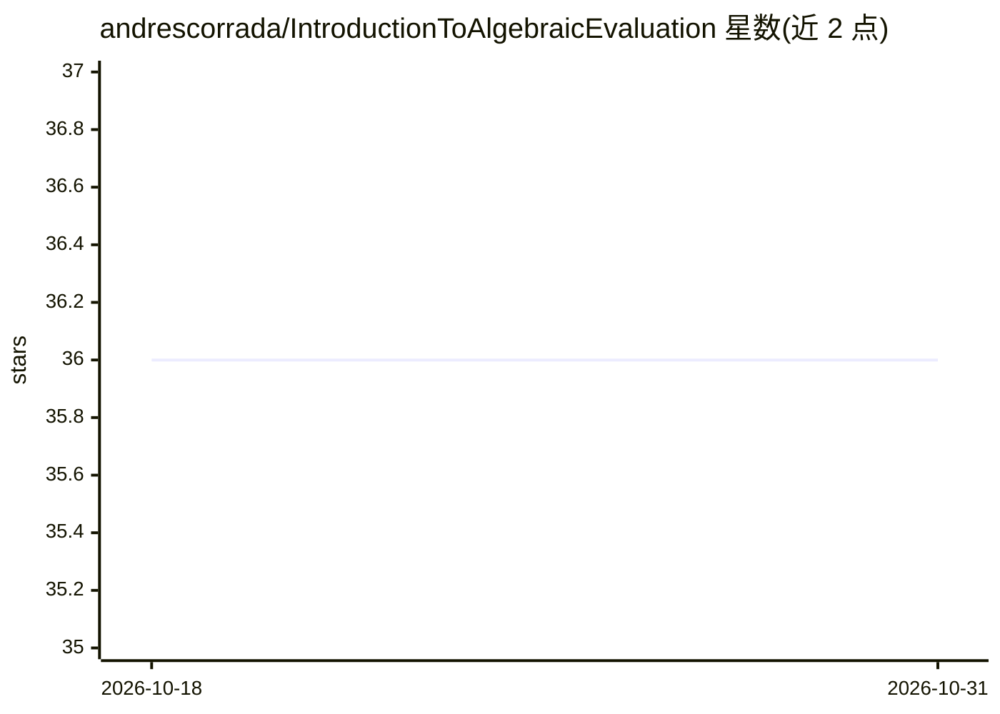

# andrescorrada/IntroductionToAlgebraicEvaluation

⭐ 36 · Jupyter Notebook · CC0-1.0 · 推送 2026-09-22 · [GitHub](https://github.com/andrescorrada/IntroductionToAlgebraicEvaluation) · 个人维护

**代数评测（NTQR）文集与代码：在无标签数据上评测噪声裁判**

关于 NTQR（分类器数 N、测试数 T、问题数 Q、候选响应数 R）代数评测方法的文集与代码集合。核心思想：将人类或机器裁判的评测视为反问题，仅用其响应的一致与分歧统计推断正确性统计，不使用概率假设、不访问模型内部，从而避开 OOD 问题并适用于任意有限测试。仓库含 Python 工具（把二分类器投票模式计数转为代数形式）、Mathematica/算法笔记本展示评测理想的多项式表示，以及两篇关于代数几何与 Regnault 激进经验主义的科普文章。代码仅覆盖误差独立情形下的二分类器。

## 筛选速览

| 维度 | 判定 | 备注 |
|---|---|---|
| AI 角色 | `ai-knowledge` | 知识聚合/清单类 |
| 许可风险 | `viral` | CC0-1.0 |
| 部署形态 | `None` |  |
| 模型依赖 | — | README 未给出锁定关系 |
| 硬件要求 | — | 无带数字的原话,不猜 |
| 安装摩擦 | `low` | 无编译、无系统依赖或容器化 |
| 成熟度 | — | 结构信号不足 |

## 能力要点

- NTQR 代数公设体系：不依赖概率假设与超参数
- 从裁判间一致/分歧统计推断无标签数据上的正确性
- AlgebraicEvaluation.py 将二分类器投票计数转为代数评测形式
- 含评测理想与代数簇的笔记本及科普文章

## 适用场景

- AI 安全研究者了解无标签数据上的评测逻辑
- 在缺少标签的部署场景中评测分类器集成
- 学习将评测表述为代数几何问题的数学方法

## 场景标签

`模型评测` · 领域:评测与运维

## 证据(README 行号)

> L3: Algebraic evaluation is the logic of evaluating noisy agents on unlabeled data.
> L139: - **AlgebraicEvaluation.py**: This Python code
> L148:  **EvaluationIdealAndVarietyErrorIndependentTrio.nb**:

## 星数曲线

2026-10-18 36 → 2026-10-31 36（+0）

---
*卡片 v1 · prompt 1.4 · 生成 2026-10-25 · 置信度 high · 依据 README sha `b8a63f90a0c6` · [字段定义](../../DATASET.md)*
