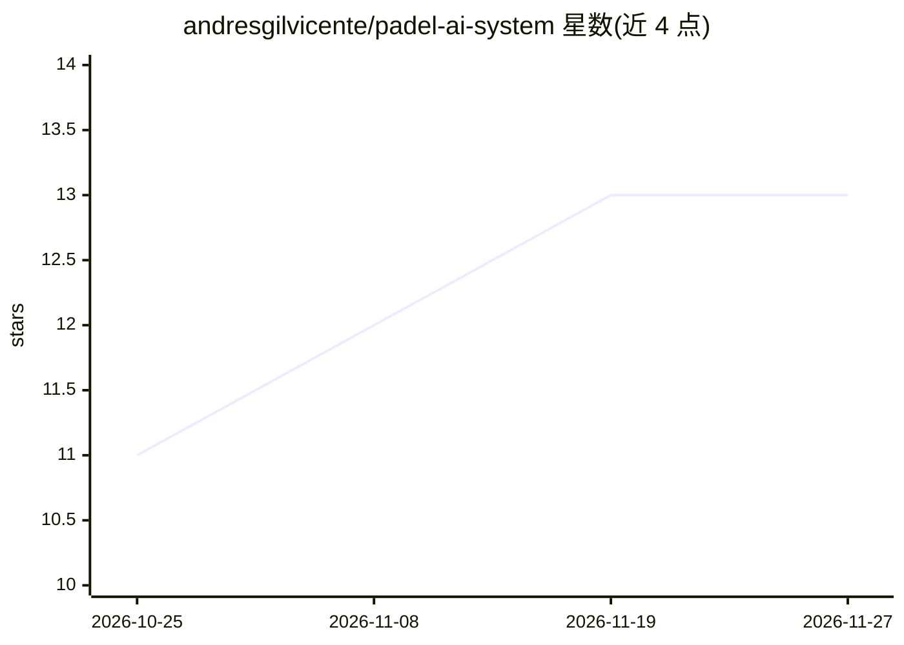

# andresgilvicente/padel-ai-system

⭐ 13 · Jupyter Notebook · 推送 2026-10-29 · [GitHub](https://github.com/andresgilvicente/padel-ai-system) · 个人维护

**用手机摄像头的板式网球自动主裁与几何图案门禁系统**

Universidad Pontificia Comillas 计算机视觉课程的双模块项目，运行于单台手机摄像头：追踪模块用 HSV 分割、MOG2 背景减除与 Kalman 滤波检测板式网球轨迹，YOLOv8-Pose 提取球员腰部/脚部关键点，通过比较击球高度与腰部高度判定发球有效或失误；安全模块以轮廓分析与凸包几何近似识别 6 种图形序列作为视觉密码解锁访问。以 Streamlit 网页面板呈现，支持多线程取流与可选 TensorRT 推理。

## 筛选速览

| 维度 | 判定 | 备注 |
|---|---|---|
| AI 角色 | `ai-native` | 本体是模型或模型工具 |
| 许可风险 | `none` | — |
| 部署形态 | `library` | 以包/库形式分发 |
| 模型依赖 | — | README 未给出锁定关系 |
| 硬件要求 | — | 无带数字的原话,不猜 |
| 安装摩擦 | `low` | 无编译、无系统依赖或容器化 |
| 成熟度 | — | 结构信号不足 |

## 能力要点

- 发球判定：加速度峰值定位击球，比对球高与 YOLO 关键点腰部高度后输出 VALID/FAULT
- 混合球检测：HSV 颜色分割 + MOG2 运动检测 + Kalman 预测与遮挡处理
- 安全模块：凸包 + Douglas-Peucker 识别线条/三角形/矩形/圆形/五边形序列解锁
- 自动保存每次发球判定的 Photo Finish 证据帧

## 适用场景

- 板式网球训练中自动判定发球是否有效
- 比赛/训练录像中追踪球的轨迹与弹跳点
- 以手机摄像头显示图形序列作为门禁访问凭证

## 场景标签

`网络安全` `目标检测` · 领域:学习与行业

## 证据(README 行号)

> L31: 2. **Tracking System (AI Chair Umpire):** An autonomous sports analysis engine capable of tracking a padel ball, de
> L31: 2. **Tracking System (AI Chair Umpire):** An autonomous sports analysis engine capable of tracking a padel ball, de

## 星数曲线

2026-10-25 11 → 2026-11-27 13（+2）

---
*卡片 v1 · prompt 1.4 · 生成 2026-11-18 · 置信度 high · 依据 README sha `d239d6360845` · [字段定义](../../DATASET.md)*
