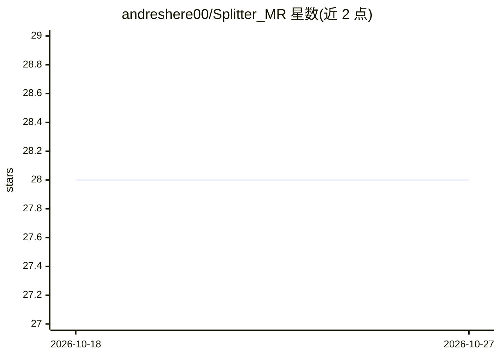

# andreshere00/Splitter_MR

⭐ 28 · Jupyter Notebook · MIT · 推送 2026-09-17 · [GitHub](https://github.com/andreshere00/Splitter_MR) · [官网](https://andreshere00.github.io/Splitter_MR/) · 个人维护

**面向 LLM 应用的文档读取与文本分块 Python 库**

SplitterMR 是将多格式数据读取并切分为 LLM 可用文本块的 Python 库。架构由 Readers、Models、Splitters、Embedders 四类组件构成：四种 Reader（Vanilla/MarkItDown/Docling/Textract）覆盖文本、Office、JSON/YAML、HTML、图像等格式并支持 Markdown 转换；提供 14 种以上切分策略（字符/词/句/段落/递归/关键词/Token/语义/HTML 标签/代码等，支持重叠）；可选接入多家 VLM 与嵌入模型用于多模态读取与语义切分。PyPI 安装，核心轻量、extras 按需扩展，v1.4.0 起提供可选 FastAPI/MCP 服务器。

## 筛选速览

| 维度 | 判定 | 备注 |
|---|---|---|
| AI 角色 | `ai-ecosystem` | LLM/agent 周边工具 |
| 许可风险 | `permissive` | MIT |
| 部署形态 | `self-host` | docker 或自建部署 |
| 模型依赖 | locked-api |  |
| 硬件要求 | — | 无带数字的原话,不猜 |
| 安装摩擦 | `low` | 无编译、无系统依赖或容器化 |
| 成熟度 | — | 结构信号不足 |

## 能力要点

- 4 种 Reader 覆盖文本、Office、表格、JSON/YAML、图像等格式，支持 Markdown 转换
- 14+ 种切分策略（字符/句子/递归/Token/语义/HTML 标签/代码等），支持块重叠
- 多模态 VLM 与嵌入模型支持 OpenAI、Azure、Grok、HuggingFace、Gemini、Claude、OpenRouter
- 可选 FastAPI/MCP 服务器暴露 read/split/read-and-split API

## 适用场景

- RAG 管线中把 PDF、Office、HTML 等文档切分为检索块
- 按 Token 数或语义相似度控制分块以适配 LLM 上下文限制
- 通过 MCP/REST 服务对外提供文档读取与切分接口

## 场景标签

`文档解析` · 领域:知识与检索

## 证据(README 行号)

> L3: **SplitterMR** is a library for chunking data into convenient text blocks compatible with your LLM applications.
> L92: **SplitterMR** is designed around a modular pipeline that processes files from raw data all the way to chunked, LLM
> L105:  - The **`BaseSplitter`** components take the **`ReaderOutput`** text content and divide that text into meaningful

## 星数曲线

2026-10-18 28 → 2026-10-27 28（+0）

---
*卡片 v1 · prompt 1.4 · 生成 2026-10-26 · 置信度 mid · 依据 README sha `54a97f2fa010` · [字段定义](../../DATASET.md)*
