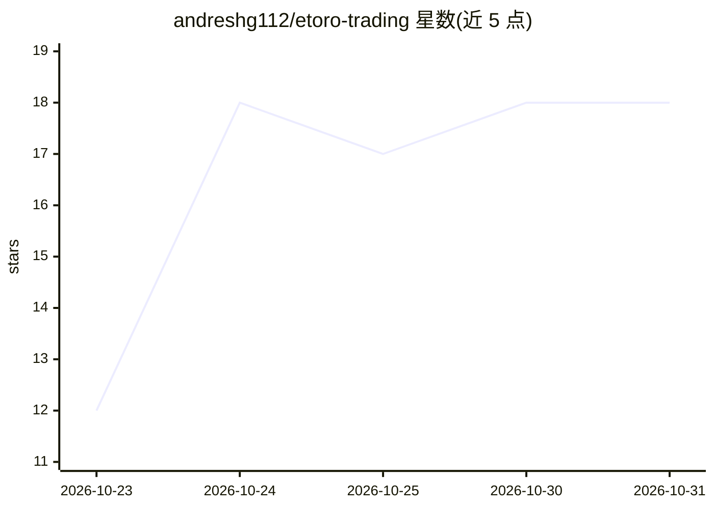

# andreshg112/etoro-trading

⭐ 18 · JavaScript · MIT · 推送 2026-10-22 · [GitHub](https://github.com/andreshg112/etoro-trading) · 个人维护

**Google Apps Script 上的 eToro 自动波段交易机器人，用 Gemini 分析行情**

运行在 Google Apps Script 无服务器环境中的自动交易机器人：定时触发器每日两次运行，通过 eToro Public API 获取行情与持仓，调用 Google Gemini 分析趋势、支撑/阻力和波动率，自主执行带强制止损/止盈与单笔不超过可用资金 10% 的波段交易；内置交易时段守卫、载荷校验与邮件告警。需要 Google 账号、eToro API Key、Gemini API Key，通过 clasp 推送部署。作者声明仅供教育实验，仅建议在 DEMO 虚拟账户模式运行。

## 筛选速览

| 维度 | 判定 | 备注 |
|---|---|---|
| AI 角色 | `ai-native` | 本体是模型或模型工具 |
| 许可风险 | `permissive` | MIT |
| 部署形态 | `library` | 以包/库形式分发 |
| 模型依赖 | — | README 未给出锁定关系 |
| 硬件要求 | — | 无带数字的原话,不猜 |
| 安装摩擦 | `low` | 无编译、无系统依赖或容器化 |
| 成熟度 | `idea` | |

## 能力要点

- Gemini 分析趋势/支撑阻力/波动率后自主执行交易
- 强制止损/止盈与单笔 10% 资金上限的风控
- 交易时段守卫：周末及 09:30–16:00 ET 之外自动跳过
- 部署前 pre-push 钩子强制通过 TypeScript 检查、ESLint 与单元测试

## 适用场景

- 在虚拟账户上实验 LLM 自主交易策略
- 学习零服务器成本的 Apps Script 自动化流水线搭建
- 以定时触发器实现多日波段持仓的自动盯盘与下单

## 场景标签

`金融量化` · 领域:学习与行业

## 证据(README 行号)

> L3: An autonomous swing-trading bot built on **Google Apps Script** that connects **eToro's Public API** with **Google G
> L32: - **Autonomous Decision Making**: Uses Google Gemini to analyze market trends, support/resistance, and volatility.

## 星数曲线

2026-10-23 12 → 2026-10-31 18（+6）

---
*卡片 v1 · prompt 1.4 · 生成 2026-10-29 · 置信度 high · 依据 README sha `e43e3e70871e` · [字段定义](../../DATASET.md)*
