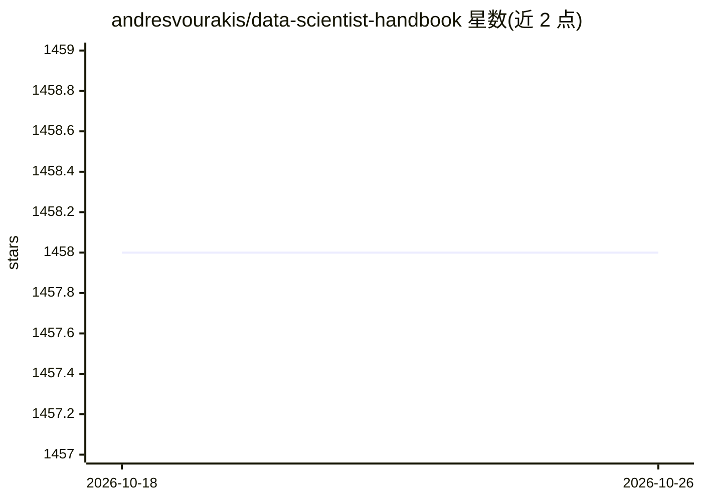

# andresvourakis/data-scientist-handbook

⭐ 1,458 · 推送 2025-12-15 · [GitHub](https://github.com/andresvourakis/data-scientist-handbook) · 个人维护

**数据科学家学习与求职的策展资源清单（免费/付费）**

面向有志与在职数据科学家的资源目录：按学习、求职、社区三大板块组织，收录 YouTube 频道、博客、通讯、播客、书籍、GitHub 仓库、面试练习平台、作品集与简历资源、导师服务及 2025 年数据科学会议信息。付费资源以美元符号标注。内容以列表形式呈现，无安装或运行流程。

## 筛选速览

| 维度 | 判定 | 备注 |
|---|---|---|
| AI 角色 | `ai-knowledge` | 知识聚合/清单类 |
| 许可风险 | `none` | — |
| 部署形态 | `None` |  |
| 模型依赖 | — | README 未给出锁定关系 |
| 硬件要求 | — | 无带数字的原话,不猜 |
| 安装摩擦 | `low` | 无编译、无系统依赖或容器化 |
| 成熟度 | — | 结构信号不足 |

## 能力要点

- 覆盖学习、面试、作品集、简历、求职市场等求职全链条资源
- 收录美国与欧洲 2025 年数据科学会议的时间、地点与费用
- 以付费符号区分免费与付费资源

## 适用场景

- 自学数据科学时寻找教程、书籍与 YouTube 频道
- 准备数据科学技术面试与制作简历作品集
- 了解 2025 年数据科学行业会议日程

## 场景标签

`精选清单` · 领域:学习与行业

## 证据(README 行号)

> L3: **Curated Data Science resources (Free & Paid) to help data scientists learn, grow, and break into the field**
> L9: # 📚 Learning Data Science
> L58: # 💼 Breaking into the Job Market

## 星数曲线

2026-10-18 1,458 → 2026-10-26 1,458（+0）

---
*卡片 v1 · prompt 1.4 · 生成 2026-10-21 · 置信度 high · 依据 README sha `7b9aee2a9dcd` · [字段定义](../../DATASET.md)*
