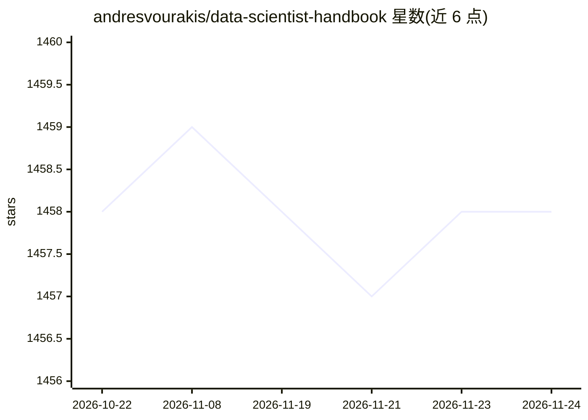

# andresvourakis/data-scientist-handbook

⭐ 1,458 · 推送 2026-11-03 · [GitHub](https://github.com/andresvourakis/data-scientist-handbook) · 个人维护

**面向数据科学学习者的资源策展清单（免费+付费）**

以 Markdown 清单形式组织的数据科学资源合集，按学习入门、求职、社区连接三大板块分类，覆盖 YouTube 频道、博客、Newsletter、播客、书籍、GitHub 仓库、技术面试练习、作品集与简历工具、就业市场仪表盘、课程与导师服务以及会议列表。每个付费资源用符号标注，求职类资源附折扣码。维护者本人也以导师/内容创作者身份出现在清单中。

## 筛选速览

| 维度 | 判定 | 备注 |
|---|---|---|
| AI 角色 | `ai-knowledge` | 知识聚合/清单类 |
| 许可风险 | `none` | — |
| 部署形态 | `None` |  |
| 模型依赖 | — | README 未给出锁定关系 |
| 硬件要求 | — | 无带数字的原话,不猜 |
| 安装摩擦 | `low` | 无编译、无系统依赖或容器化 |
| 成熟度 | — | 结构信号不足 |

## 能力要点

- 按学习、求职、社区三大板块组织的数据科学资源分类清单
- 免费与付费资源混合，付费条目以符号标注
- 包含技术面试练习、作品集/简历工具与就业市场仪表盘
- 附美国与欧洲的 ML/AI 会议列表及费用信息

## 适用场景

- 想进入数据科学领域的学习者寻找系统学习资料
- 准备数据科学/SQL 技术面试时练习真题
- 规划作品集和简历并了解数据岗位就业市场

## 场景标签

`精选清单` · 领域:学习与行业

## 证据(README 行号)

> L3: **Curated Data Science resources (Free & Paid) to help data scientists learn, grow, and break into the field**
> L9: # 📚 Learning Data Science
> L62: # 💼 Breaking into the Job Market

## 星数曲线

2026-10-22 1,458 → 2026-11-24 1,458（+0）

---
*卡片 v1 · prompt 1.4 · 生成 2026-11-23 · 置信度 high · 依据 README sha `c913242e97b4` · [字段定义](../../DATASET.md)*
