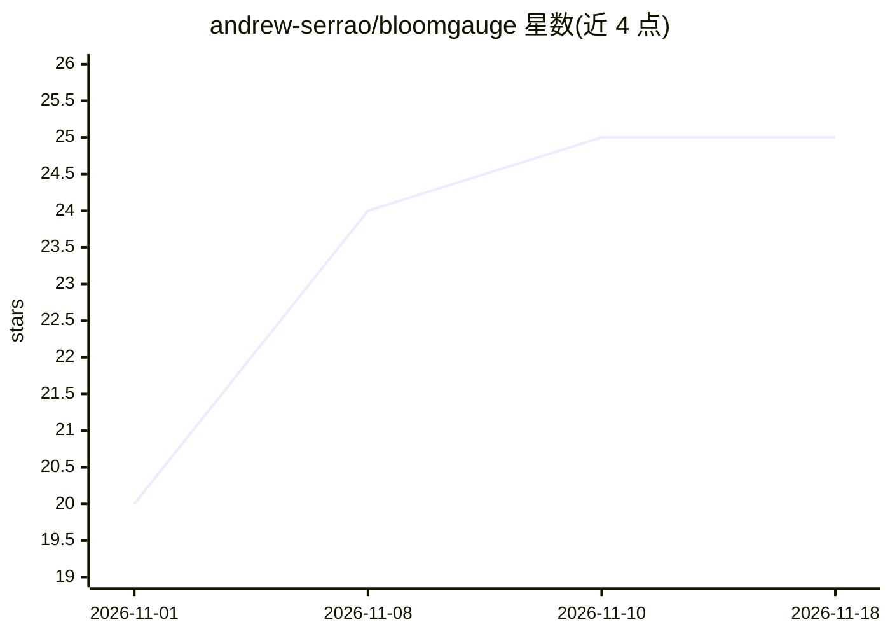

# andrew-serrao/bloomgauge

⭐ 25 · Python · NOASSERTION · 推送 2026-11-17 · [GitHub](https://github.com/andrew-serrao/bloomgauge) · [官网](https://bloomgauge.io) · 个人维护

**Mac 上 Darkbloom 供给的收益面板与模型管理器**

面向 Apple Silicon Mac 用户的原生 macOS 应用，作为 Darkbloom 供给端的免费配套工具：展示确认收益、网络需求与硬件读数；Manager 功能保持所选模型运行并在停滞后恢复，仅在另一模型预期收益高出 25% 以上持续 15 分钟时切换。内置 Python 后端读取 ~/.darkbloom 状态与账户 API，本地 SQLite 存储，dashboard 服务于 127.0.0.1:8765。本仓库为 PolyForm Shield 源码可用核心（落后于官网应用），需 macOS 14+ 与 Darkbloom 账户。

## 筛选速览

| 维度 | 判定 | 备注 |
|---|---|---|
| AI 角色 | `ai-ecosystem` | LLM/agent 周边工具 |
| 许可风险 | `none` | NOASSERTION |
| 部署形态 | `desktop` | 安装包/桌面程序 |
| 模型依赖 | — | README 未给出锁定关系 |
| 硬件要求 | — | 无带数字的原话,不猜 |
| 安装摩擦 | `low` | 无编译、无系统依赖或容器化 |
| 成熟度 | — | 结构信号不足 |

## 能力要点

- 确认收益按模型/小时展示，附实时 Pulse 支付率
- Manager 自动恢复停滞并按收益阈值切换模型（每小时至多两次）
- 可选 Tailscale 手机端只读访问，支持最多十台 Mac 汇总视图
- 本地运行：读取 ~/.darkbloom 状态与硬件传感器，数据存 SQLite

## 适用场景

- 查看我的 Mac 做 Darkbloom 供给的收益与网络需求
- 让 Manager 自动保持高收益模型运行并处理停滞
- 用手机通过自己的 Tailscale 网络远程查看与切换模型

## 场景标签

`推理引擎` · 领域:训练与推理

## 证据(README 行号)

> L9: Darkbloom pays Mac owners to serve AI inference on idle hardware. What you earn depends heavily on which model your 
> L67: Model changes go through Darkbloom's own CLI (`~/.darkbloom/bin/darkbloom`). BloomGauge never touches payouts, with

## 星数曲线

2026-11-01 20 → 2026-11-18 25（+5）

---
*卡片 v1 · prompt 1.4 · 生成 2026-11-18 · 置信度 mid · 依据 README sha `8ad6738b635e` · [字段定义](../../DATASET.md)*
