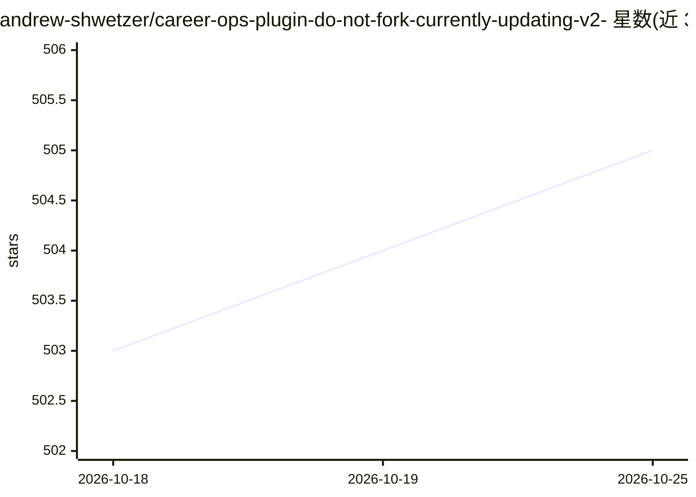

# andrew-shwetzer/career-ops-plugin-do-not-fork-currently-updating-v2-

⭐ 505 · HTML · MIT · 推送 2026-07-23 · [GitHub](https://github.com/andrew-shwetzer/career-ops-plugin-do-not-fork-currently-updating-v2-) · 个人维护

**给求职者的 Claude Cowork 插件：职位评估与求职全流程技能**

适配 Claude Cowork 的求职插件，提供 9 项技能：评估职位发布（A-F 报告，含背景匹配、定位策略、薪酬与面试准备）、生成 ATS 优化简历、扫描公司招聘门户、快速分级、申请跟踪、填表、公司调研、撰写联系消息与机会对比。覆盖 15 种行业原型并调整评分权重。数据（简历/申请记录）保存在本地 data/ 目录并从 git 排除，除 Claude 自身的网络搜索与 ATS API 调用外不外发。

## 筛选速览

| 维度 | 判定 | 备注 |
|---|---|---|
| AI 角色 | `ai-native` | 本体是模型或模型工具 |
| 许可风险 | `permissive` | MIT |
| 部署形态 | `None` |  |
| 模型依赖 | — | README 未给出锁定关系 |
| 硬件要求 | — | 无带数字的原话,不猜 |
| 安装摩擦 | `low` | 无编译、无系统依赖或容器化 |
| 成熟度 | — | 结构信号不足 |

## 能力要点

- 9 项求职技能：评估、简历定制、门户扫描、申请跟踪、outreach 起草等
- A-F 六段式职位评估报告（高管摘要/背景匹配/定位/薪酬/定制计划/面试准备），1.0-5.0 评分
- 15 个行业原型，各行业调整评分权重与评估语言
- 用户数据留在本地 data/ 目录，通过 .gitignore 排除

## 适用场景

- 粘贴职位发布，让 AI 评估匹配度并给出定位策略
- 针对目标岗位生成 ATS 优化简历
- 扫描公司招聘门户并跟踪申请进度、起草 LinkedIn/邮件联系消息

## 场景标签

`AI 助手` · 领域:对话与助手

## 证据(README 行号)

> L3: A Claude Cowork plugin that turns your job search into a system. Evaluate job postings, generate ATS-optimized resum
> L31: |**evaluate**|Score a job posting A-F with detailed analysis|"Evaluate this job posting"|

## 星数曲线

2026-10-18 503 → 2026-10-25 505（+2）

---
*卡片 v1 · prompt 1.4 · 生成 2026-10-21 · 置信度 high · 依据 README sha `a3222ad07c0f` · [字段定义](../../DATASET.md)*
