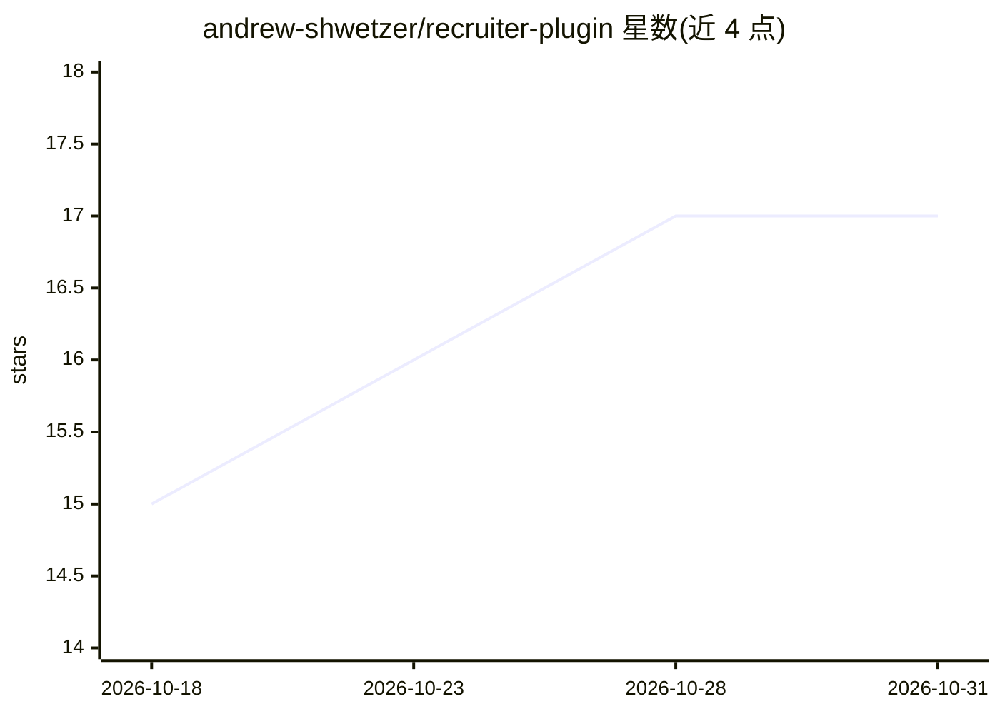

# andrew-shwetzer/recruiter-plugin

⭐ 17 · Python · 推送 2026-04-28 · [GitHub](https://github.com/andrew-shwetzer/recruiter-plugin) · 个人维护

**面向招聘者的 Claude Code 插件：22 个招聘技能装进终端**

安装在 Claude Code 内的插件包，以纯 markdown 技能文件形式提供 22 个招聘命令：检测目标公司招聘信号并打分、生成公司情报简报、起草 3 封冷邮件序列、简历筛选、9 维度候选人评分、LinkedIn 候选人搜寻、招聘经理定位、pipeline 跟踪等。7 个技能零 API key 可用，其余需 RapidAPI/Hunter.io/Icypeas 订阅（约 $50–109/月）。无服务器无 SaaS，数据与 API key 存本地 ~/.recruiter-skills/。

## 筛选速览

| 维度 | 判定 | 备注 |
|---|---|---|
| AI 角色 | `ai-native` | 本体是模型或模型工具 |
| 许可风险 | `none` | — |
| 部署形态 | `None` |  |
| 模型依赖 | — | README 未给出锁定关系 |
| 硬件要求 | — | 无带数字的原话,不猜 |
| 安装摩擦 | `low` | 无编译、无系统依赖或容器化 |
| 成熟度 | — | 结构信号不足 |

## 能力要点

- 22 个斜杠命令覆盖寻源、信号检测、简历筛选、外联起草与 pipeline 跟踪
- 7 个技能无需任何 API key 即可用
- 技能为纯 markdown 文件，可直接编辑定制
- API key 与数据全部本地存储

## 适用场景

- 扫描目标公司的招聘信号并自动保存为线索
- 为公司研究并起草针对招聘经理的冷邮件序列
- 按职位描述筛选简历并做 9 维度匹配评分
- 在终端里查看和更新招聘 pipeline

## 场景标签

`AI 写作` · 领域:内容生成

## 证据(README 行号)

> L1: # Recruiter Skills Pack for Claude Code
> L3: A Claude Code plugin: 22 AI recruiting skills installed into your terminal. Source candidates, detect hiring signals

## 星数曲线

2026-10-18 15 → 2026-10-31 17（+2）

---
*卡片 v1 · prompt 1.4 · 生成 2026-10-29 · 置信度 high · 依据 README sha `f7066fa6495d` · [字段定义](../../DATASET.md)*
