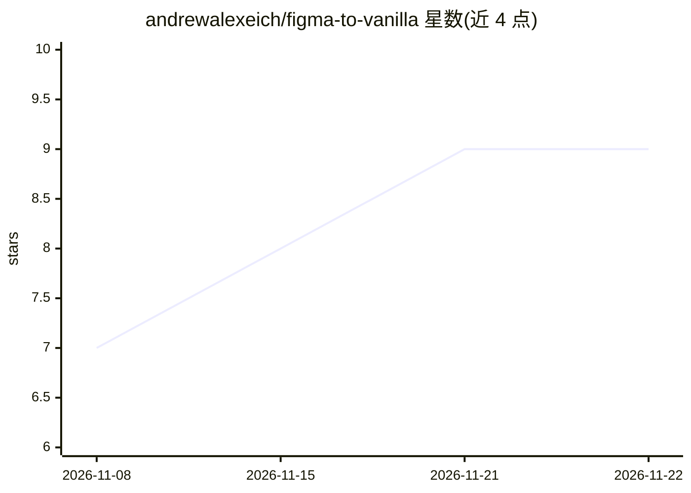

# andrewalexeich/figma-to-vanilla

⭐ 9 · JavaScript · MIT · 推送 2026-11-18 · [GitHub](https://github.com/andrewalexeich/figma-to-vanilla) · 个人维护

**面向 AI 编码代理的 Figma 转原生 HTML/CSS/JS 技能集**

以 Agent Skills 格式组织的模块化技能：主 SKILL.md 调度十余个技术参考文件，覆盖设计分析、Figma MCP 数据读取、布局实现、响应式处理、动画、像素级视觉核验与生产准备（压缩、WebP 转换）。面向需要把 Figma 设计稿转成无框架网页的前端开发者、工作室与设计师。附带三套环境预检脚本（shell/Python/Node）检测工具可用性，缺依赖时仅提示安装指引，不自动安装。

## 筛选速览

| 维度 | 判定 | 备注 |
|---|---|---|
| AI 角色 | `ai-knowledge` | 知识聚合/清单类 |
| 许可风险 | `permissive` | MIT |
| 部署形态 | `library` | 以包/库形式分发 |
| 模型依赖 | — | README 未给出锁定关系 |
| 硬件要求 | — | 无带数字的原话,不猜 |
| 安装摩擦 | `low` | 无编译、无系统依赖或容器化 |
| 成熟度 | — | 结构信号不足 |

## 能力要点

- 模块化技能架构：主 SKILL.md 按任务加载 13 个技术参考文件
- 通过 Figma MCP 读取 Auto Layout、组件、变量、资产等设计数据
- 三套预检脚本（preflight.sh/.py/.mjs）生成共享 config.env
- 支持单页与多页两种网站结构，src/ 与 build/ 分离

## 适用场景

- 把 Figma 设计稿生成无框架依赖的 HTML/CSS/JS 页面
- 为 CMS/后端项目准备可集成的原生网页标记
- 在 Claude Code、Codex 等代理中执行设计到代码的完整流程

## 场景标签

`编码 Agent` · 领域:编码与开发

## 证据(README 行号)

> L33: **Figma to Vanilla** is a modular AI Agent Skill designed to turn Figma designs into accurate, responsive, and main
> L128: The main `SKILL.md` defines the overall workflow and determines which technical references are relevant to the cur
> L221: The skill uses the Agent Skills format and is intended for AI coding agents that support this format.

## 星数曲线

2026-11-08 7 → 2026-11-22 9（+2）

---
*卡片 v1 · prompt 1.4 · 生成 2026-11-20 · 置信度 high · 依据 README sha `142dcb34fb8d` · [字段定义](../../DATASET.md)*
