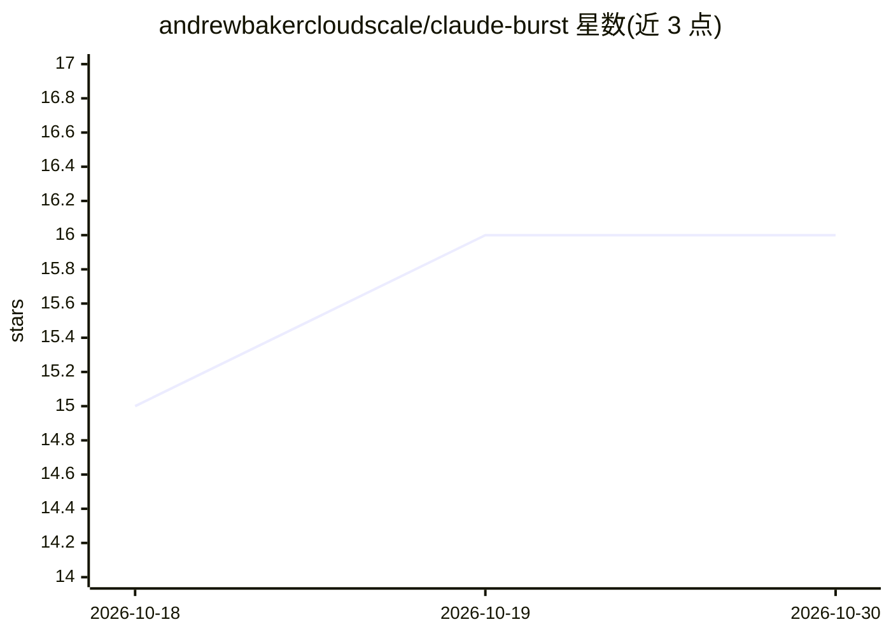

# andrewbakercloudscale/claude-burst

⭐ 16 · Go · MIT · 推送 2026-10-28 · [GitHub](https://github.com/andrewbakercloudscale/claude-burst) · [官网](https://andrewbaker.ninja/2026/08/28/two-prices-for-the-same-model-building-claude-burst/) · 个人维护

**Mac 上长时间运行 Claude Code/Codex 的本地网关与运维面板**

本地网关，部署在 Claude Code（及 OpenAI Codex）与 Anthropic 之间：订阅额度优先路由，仅在额度耗尽时溢出到 GLM/OpenRouter/Bedrock/Together 等；提供按仓库学习的上下文压缩、并行会话协调与交接、合盖保持运行与热点自动加入、成本/健康/守卫仪表盘、支持控制台与一键修复/诊断/回滚脚本。面向 Mac 上重度使用 Claude Code 的 Pro/Max/Enterprise 或 API key 用户，macOS 专属、自述为实验性。通过 git clone 源码安装，需 Go 1.23+ 与 Xcode 命令行工具。

## 筛选速览

| 维度 | 判定 | 备注 |
|---|---|---|
| AI 角色 | `ai-ecosystem` | LLM/agent 周边工具 |
| 许可风险 | `permissive` | MIT |
| 部署形态 | `desktop` | 安装包/桌面程序 |
| 模型依赖 | locked-api |  |
| 硬件要求 | — | 无带数字的原话,不猜 |
| 安装摩擦 | `medium` | 含编译或系统依赖之一 |
| 成熟度 | `idea` | |

## 能力要点

- 订阅优先路由：仅在额度实际耗尽时按模型溢出到付费二级提供商
- 按各仓库近 14 天数据自适应学习压缩时机的 compaction
- 并行会话协调与 HANDOFF.md 会话交接
- 支持控制台（127.0.0.1:7789）+ Repair/Diagnose/一键回滚脚本

## 适用场景

- 订阅额度用尽时不断档，自动溢出到付费渠道继续工作
- 长会话中管理上下文压缩与成本
- 合盖携带时保持会话运行并自动加入热点

## 场景标签

`模型网关` `LLM 可观测性` · 领域:Agent 开发

## 证据(README 行号)

> L18: The ops layer for running Claude Code all day on a Mac, and now OpenAI's Codex too: subscription-first routing with
> L38: Claude Burst is a local gateway that sits between Claude Code and Anthropic. **It is for** people who use Claude Co

## 星数曲线

2026-10-18 15 → 2026-10-30 16（+1）

---
*卡片 v1 · prompt 1.4 · 生成 2026-10-30 · 置信度 high · 依据 README sha `3b74010c2937` · [字段定义](../../DATASET.md)*
