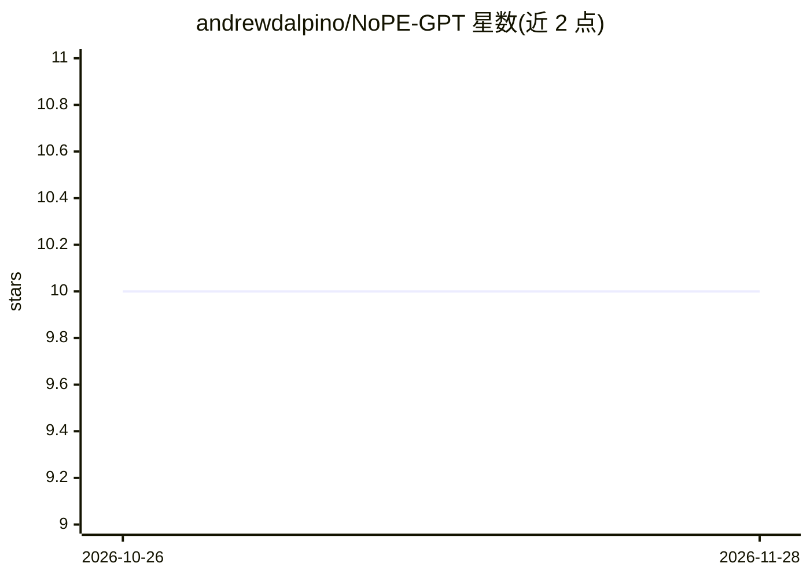

# andrewdalpino/NoPE-GPT

⭐ 10 · Python · Apache-2.0 · 推送 2026-02-11 · [GitHub](https://github.com/andrewdalpino/NoPE-GPT) · 个人维护

**无位置编码的 GPT 小型语言模型，可自训练微调**

基于 PyTorch 实现的 GPT 风格生成式语言模型，架构上完全移除位置编码（NoPE），使上下文长度可变化而无需修改模型结构。训练数据来自 HuggingFace 的 Fineweb、SmolTalk、UltraFeedback 数据集，预训练模型可回答问题、摘要文档、使用工具。提供推理、预训练与微调（含 LoRA/QLoRA）的完整代码，采用 GQA、Flash Attention、KV 缓存等优化，支持 torchrun 分布式训练。以 pip 包提供推理，训练需 clone 仓库并安装 requirements.txt。

## 筛选速览

| 维度 | 判定 | 备注 |
|---|---|---|
| AI 角色 | `ai-native` | 本体是模型或模型工具 |
| 许可风险 | `permissive` | Apache-2.0 |
| 部署形态 | `library` | 以包/库形式分发 |
| 模型依赖 | — | README 未给出锁定关系 |
| 硬件要求 | — | 无带数字的原话,不猜 |
| 安装摩擦 | `medium` | 含编译或系统依赖之一 |
| 成熟度 | — | 结构信号不足 |

## 能力要点

- 架构移除位置编码（NoPE），上下文长度可变
- 提供预训练、微调（LoRA/QLoRA）与推理完整代码
- GQA、Flash Attention、KV 缓存、FSDP 等训练/推理优化
- 开放模型权重与源码，可在自有硬件上训练与生成

## 适用场景

- 加载预训练模型进行文本生成或对话
- 在自有硬件上预训练或指令微调小模型
- 研究无位置编码架构的上下文泛化行为

## 场景标签

`微调` `模型训练` · 领域:训练与推理

## 证据(README 行号)

> L3: NoPE GPT is a generative pretrained Transformer-style (GPT) language model with no positional embeddings (NoPE). Bui
> L9: - **Fast and memory-efficient**: NoPE GPT employs a number of training and inference-time optimizations such as Grou
> L90: In addition to the inference code, we also provide training and fine-tuning code so you can build your own NoPE GPT

## 星数曲线

2026-10-26 10 → 2026-11-28 10（+0）

---
*卡片 v1 · prompt 1.4 · 生成 2026-11-20 · 置信度 high · 依据 README sha `f61fd537eb87` · [字段定义](../../DATASET.md)*
