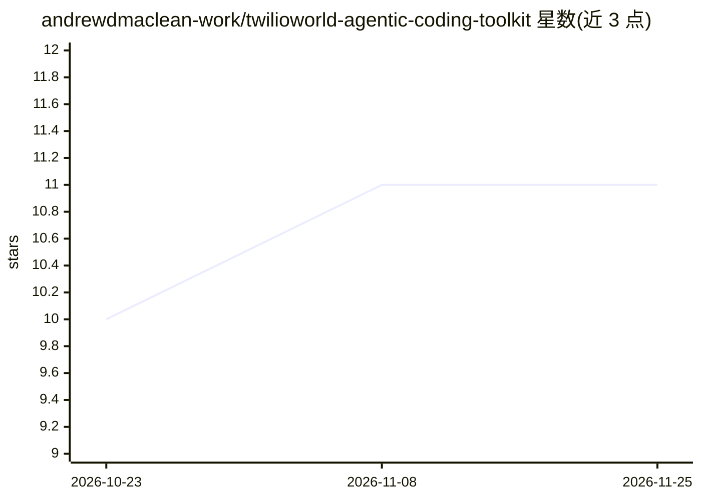

# andrewdmaclean-work/twilioworld-agentic-coding-toolkit

⭐ 11 · TypeScript · 推送 2026-09-01 · [GitHub](https://github.com/andrewdmaclean-work/twilioworld-agentic-coding-toolkit) · [官网](https://twilio.world) · 组织维护

**为 AI 编码代理注入 Twilio 知识与文档检索的终端工具包**

面向使用 AI 编码代理的 Twilio 开发者的终端仪表盘工具：为 Claude Code、Codex、Cursor 等代理配置 Twilio Skills（产品指南、架构、合规模式）与只读的实时 Docs MCP 检索。附带可选的本地聊天（llamafile 运行 Gemma 4 E2B 或 Phi-4-mini，OpenAI 兼容端点）、浏览器软电话 Dev Phone 与隔离的 Twilio CLI。工具包本身不向代理提供账户鉴权访问；Windows 原生启动暂不支持。

## 筛选速览

| 维度 | 判定 | 备注 |
|---|---|---|
| AI 角色 | `ai-ecosystem` | LLM/agent 周边工具 |
| 许可风险 | `none` | — |
| 部署形态 | `None` |  |
| 模型依赖 | — | README 未给出锁定关系 |
| 硬件要求 | — | 无带数字的原话,不猜 |
| 安装摩擦 | `low` | 无编译、无系统依赖或容器化 |
| 成熟度 | `idea` | |

## 能力要点

- 为 6 类编码代理自动配置 Twilio Skills 与 Docs MCP
- llamafile 本地模型提供 OpenAI 兼容端点（127.0.0.1:8080）
- 隔离的 Twilio CLI 与 Dev Phone 软电话用于真实短信/语音测试
- ./toolkit doctor 只读环境自检

## 适用场景

- 让编码代理生成符合 Twilio 架构与合规模式的实现
- 离线环境下私下查询 Twilio 文档与 API schema
- 用浏览器软电话测试真实短信与语音流程

## 场景标签

`RAG` · 领域:知识与检索

## 证据(README 行号)

> L6: Give coding agents reliable Twilio context with Twilio Skills and live,
> L43: |Coding-agent setup|Adds Skills and Docs to Claude Code, Codex, Cursor, OpenCode, Copilot, or Pi|Agent-specific sig

## 星数曲线

2026-10-23 10 → 2026-11-25 11（+1）

---
*卡片 v1 · prompt 1.4 · 生成 2026-11-18 · 置信度 high · 依据 README sha `5f6adc429523` · [字段定义](../../DATASET.md)*
