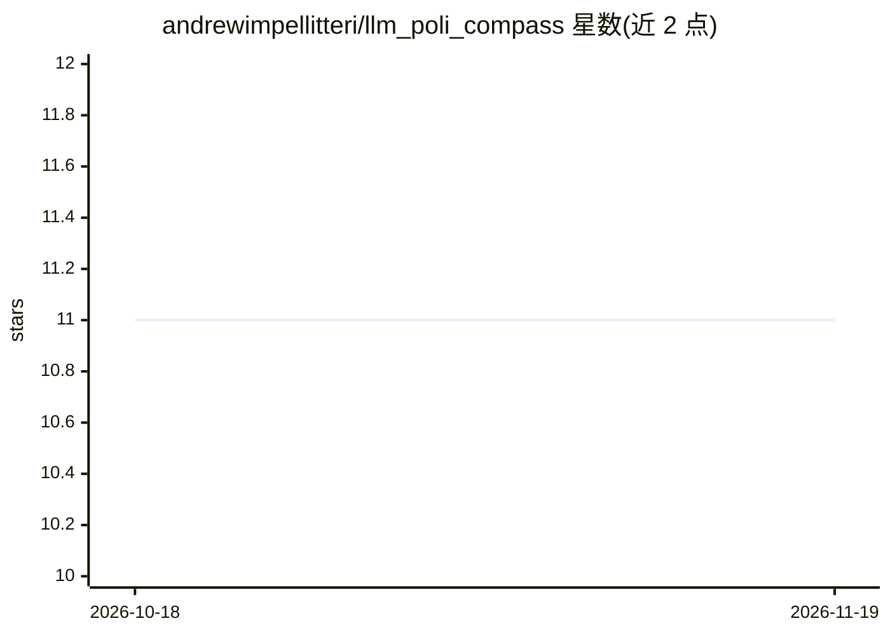

# andrewimpellitteri/llm_poli_compass

⭐ 11 · Python · MIT · 推送 2026-08-24 · [GitHub](https://github.com/andrewimpellitteri/llm_poli_compass) · 个人维护

**测试开源 LLM 政治倾向得分的自动化评测工具**

一个通过命令行对语言模型运行政治倾向测试的工具：支持 classic、8values 测试及专门的左右偏差评估（lr_bias），另有 character 测试让模型分别扮演四个象限并取平均以探测偏差。通过 llama-cpp-python 调用本地模型，支持多种提示模板并可自定义预提示，结果以图表显示并可多次运行取平均。需通过 git clone 与 pip 安装依赖后以 Python 运行。

## 筛选速览

| 维度 | 判定 | 备注 |
|---|---|---|
| AI 角色 | `ai-ecosystem` | LLM/agent 周边工具 |
| 许可风险 | `permissive` | MIT |
| 部署形态 | `library` | 以包/库形式分发 |
| 模型依赖 | — | README 未给出锁定关系 |
| 硬件要求 | — | 无带数字的原话,不猜 |
| 安装摩擦 | `low` | 无编译、无系统依赖或容器化 |
| 成熟度 | — | 结构信号不足 |

## 能力要点

- 支持 classic、8values、lr_bias、character 四类测试
- character 测试以四象限角色扮演取平均探测偏差
- 使用 llama-cpp-python 调用本地模型
- 支持自定义预提示与 Llama-2/Alpaca/Vicuna/ChatLM 提示格式

## 适用场景

- 测试本地开源模型的政治倾向得分
- 对比不同提示模板下模型的回答偏差
- 多次运行取平均以观察模型回答的稳定性

## 场景标签

`模型评测` · 领域:评测与运维

## 证据(README 行号)

> L3: A utility for running tests on language models to evaluate their political bias. It supports both classic and eightv
> L11: test_llm [MODEL_PATH] [TEST_TYPE] [PROMPT_FORMAT] [options]

## 星数曲线

2026-10-18 11 → 2026-11-19 11（+0）

---
*卡片 v1 · prompt 1.4 · 生成 2026-11-18 · 置信度 high · 依据 README sha `74e75eee0143` · [字段定义](../../DATASET.md)*
