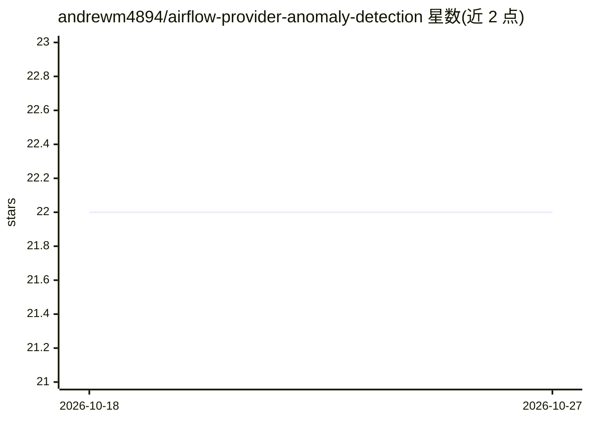

# andrewm4894/airflow-provider-anomaly-detection

⭐ 22 · Python · Apache-2.0 · 推送 2026-08-11 · [GitHub](https://github.com/andrewm4894/airflow-provider-anomaly-detection) · [官网](https://pypi.org/project/airflow-provider-anomaly-detection/) · 个人维护

**基于 PyOD 的 Airflow 异常检测 provider：SQL 指标自动训练评分告警**

Apache Airflow 的异常检测 provider 包：用户用 SQL 查询定义指标，通过 YAML 配置后，自动生成 ingestion、training、scoring、alerting 四类 DAG——用 PyOD 为每个指标训练模型（存至 GCS）、对最新数据打分、满足告警条件时经 Sendgrid 发送邮件告警（附 ASCII 图表与图表附件）。当前仅支持 BigQuery 作为数据源，计划支持 Snowflake/Redshift。提供 PyPI 安装与 docker compose 快速体验环境。

## 筛选速览

| 维度 | 判定 | 备注 |
|---|---|---|
| AI 角色 | `ai-native` | 本体是模型或模型工具 |
| 许可风险 | `permissive` | Apache-2.0 |
| 部署形态 | `self-host` | docker 或自建部署 |
| 模型依赖 | — | README 未给出锁定关系 |
| 硬件要求 | — | 无带数字的原话,不猜 |
| 安装摩擦 | `low` | 无编译、无系统依赖或容器化 |
| 成熟度 | — | 结构信号不足 |

## 能力要点

- 每个指标批量自动生成 ingestion/training/scoring/alerting 四个 DAG
- 基于 PyOD 训练并保存各指标的异常检测模型至 GCS
- 告警邮件附 ASCII 图表与图表附件，平滑异常分超阈值触发
- 提供 docker compose 一键运行 Airflow 实例与示例 DAG

## 适用场景

- 在 Airflow 中对业务指标做自动化异常检测与告警
- 用 SQL 定义指标后自动获得训练、评分、告警流水线
- 本地用 docker compose 快速试用异常检测流程

## 场景标签

`MLOps` · 领域:训练与推理

## 证据(README 行号)

> L3: Painless anomaly detection (using PyOD) with Apache Airflow.
> L24: - `<dag_name_prefix><metric_batch_name>_training<dag_name_suffix>`: Uses recent metrics and `preprocess.sql` to tra

## 星数曲线

2026-10-18 22 → 2026-10-27 22（+0）

---
*卡片 v1 · prompt 1.4 · 生成 2026-10-27 · 置信度 high · 依据 README sha `99330dbc4560` · [字段定义](../../DATASET.md)*
